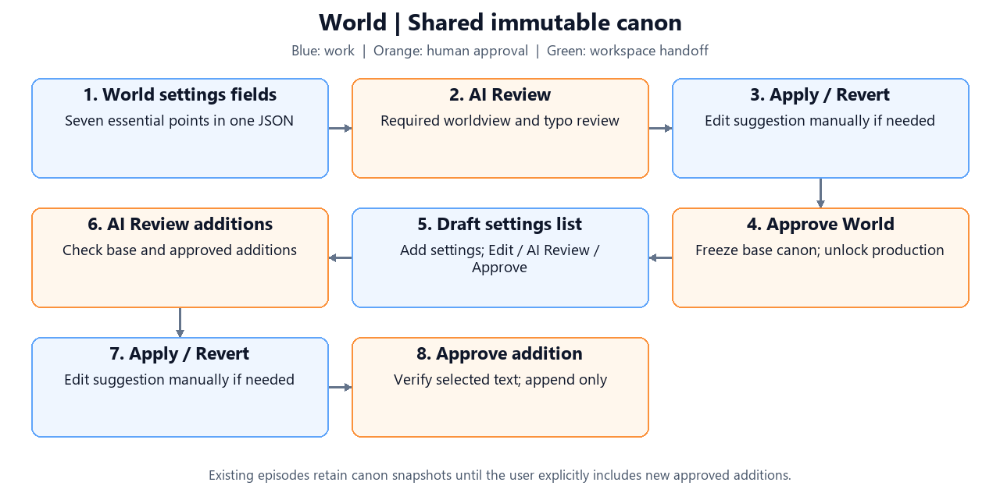

Current phase: **3 — Animation and continuity**.

# Story Studio

Build an approved World, reusable assets and independently reviewed episodes, then produce animated scenes and a finished video. Provider/model configuration follows **v0.3**, with the World/episode workflow described below; see the [implementation audit and remaining acceptance work](docs/spec-alignment.md).

## Start the app

Requires **Python 3.11+**. Run in PowerShell from this directory:

```powershell
# Once: create an isolated Python environment.
python -m venv .venv

# Install the app and testing tools; -e makes source edits take effect immediately.
.\.venv\Scripts\python -m pip install -e ".[dev]"

# Start the web interface; open the local URL printed in the terminal.
.\.venv\Scripts\python -m streamlit run app.py
```

Activation is unnecessary because commands use the virtual environment directly. FFmpeg is supplied through `imageio-ffmpeg`.

Dialogs open before loading their data and show a loading indicator during preparation, including API spending/quota checks. Opening a dialog does not wait for the workspace tables to rebuild.

Click the **key icon beside Deploy in the top toolbar** (tooltip: **API key**) to save credentials:

| Key | Purpose |
| --- | --- |
| `OPENAI_API_KEY` | Story, Script, Performance metadata, panorama masters, prompt compilation, typo checks and alignment |
| `RUNWAYML_API_SECRET` | Gen-4 character images, Kling O3 Pro and selected Act-Two performances |
| `ELEVENLABS_API_KEY` | Eleven v4 voices and generated SFX / ambience |
| `OPENAI_ADMIN_KEY` — optional | OpenAI organization billing reports |

Saved keys show only their first and last four characters; short values stay fully masked. A red hint below each missing key's title says it is not provided. Replacement fields start blank: blank keeps the current key, **Clear** removes it. **Save API keys** writes the local `.env` and updates future requests without restarting. Keys apply across projects; changing them waits for active generation. Sync credentials and controls are removed for now.

Each provider has a dark grey box; both OpenAI keys share one box. Opening the dialog automatically checks all saved providers in parallel; refresh buttons check again. OpenAI shows reported month-to-date spending in USD using the admin key (UTC calendar month). Runway shows remaining credits; ElevenLabs shows used and remaining character quota, period allowance, and reset time. **Spent amounts are red; remaining balances are green.** Account totals apply across projects, reported spending may lag, and each result shows its last check time. Save replacement keys before checking them.

Alternatively, edit `.env` manually and restart. It is plaintext and excluded from Git; existing process environment values take precedence.

```powershell
# Create a settings template only if .env does not already exist.
if (-not (Test-Path .env)) { Copy-Item .env.example .env }

# Edit local credentials and settings.
notepad .env
```

**Demo (offline)** uses sample stories, placeholder images, silent voices and sample timing. New World/episode reviews return offline sample responses in Demo. Existing editors' explicitly named provider actions, including OpenAI typo checks and modifications, use that service and can incur charges. Assets has a separate production/demo selector.

<a id="workspace-map"></a>
## Workspace map

[](#workspace-map)

| Page | Contents |
| --- | --- |
| [World](#world) (default) | World settings, AI review, immutable approval, pending/approved additions |
| [Assets](#assets) | Character References (Visual, Voice, Costumes), Background, SFX, Props, Style check |
| [Story/Episode](#story-episode) | Outline -> Story -> Script -> Storyboard -> Prompts, with separate approvals |
| [Animations](#animations) | Scene images -> Direction & performance -> Animated scenes -> Voices & input -> Video effects -> Sound effects -> Scene review & continuity |
| [Final](#final) | Timeline, subtitle, mixing, assembly, downloads and final approval |
| [Analytics](#analytics) | Generation cost, provider statistics, request attribution and billing reports |

World approval unlocks production pages. Navigation preserves drafts and background work. Generate buttons show **Generating…** or **Queuing…**. Independent voice samples, talking samples, voice-design prompts and OpenAI design-reference requests can overlap with asset generation, including within one project. Provider limits across this app server are **OpenAI 2, Runway 1, ElevenLabs 2**: at most **5 simultaneous generation requests**. The task table shows per-service activity, queued requests and results waiting to save. Completed requests release their service slot while waiting for a protected file commit. Voice revisions merge under short file transactions; ledger/manifest writes preserve every request's cost. Same-character sample requests, project mutations and production writers keep their dependency order; location masters precede views and orbit segments chain sequentially. Failed jobs do not block independent work. **Stop after running tasks** stops all active pipelines after their current request and clears pending work. These limits do not coordinate separate app-server processes.

Failed requests save sanitized provider responses under each project's `error_reports/` folder. **Error Report** beside an error opens the task's failed attempts, HTTP status, request IDs and response bodies. Reports include asynchronous failures returned through HTTP 200 and errors without a response. A successful task removes its reports, leaving other tasks' failures intact. Earlier failures may have no saved response.

**Delete project** is below the sidebar project selector. Its dialog requires the full project name exactly before **Delete** is enabled; **Cancel** closes it. Deletion permanently removes the World and its episodes, generated files, history and local usage records. Active generation blocks deletion. Other projects and saved API keys are retained.

<a id="world"></a>
## World

[](#world)

World settings are saved in **`world_setting.json`** and displayed as text fields for **premise, era/setting, core rules, technology/magic and limits, society/key places, tone, and forbidden contradictions**. A sentence or two per decided point is enough; leave unknown fields blank. Organizations and historical timelines can be added later. An optional World name supplies the project title. See the concise [example JSON draft](input/world_setting.json).

**First draft (edit) -> AI Review -> Apply / Revert (manual editing allowed) -> Approve**

**Generation preferences** is a text button at the top right, beside the API key button. Its **OpenAI** tab selects a model per text process. **Balance** (default) uses GPT-6.1 Sol, with GPT-6 Luna for separate metadata work; **Economic** uses GPT-6 Luna throughout. Select GPT-6 Astra manually for important episodes, complex canon conflicts or deeper story review; GPT-5.6 Sol is also available. Hover over the information icon for model guidance, then **Save preferences**. Choices are shared by the World and its episodes and apply to future requests without invalidating approved work. Dedicated image/video/speech models remain in their media settings.

Choose **Default language** when creating the World, or change it with **Save World draft** before approval. It is saved in `world_setting.json` and the project configuration; generated content and new episodes use this language. Changing it clears the draft's AI review. It is locked with the approved settings. Existing projects retain their configured language.

1. Create a project with World settings only. The first line supplies its initial title; episode titles and lengths are entered later.
2. Save the draft and run **AI review**. **Modify with prompt** performs the same review with your direction. After review, settings and both review versions appear as text with bold point titles. Use **Edit World draft** or **Edit suggestion** when manual changes are needed, then explicitly Apply or Revert. Review and a decision are required even when AI suggests no changes. Saving a different draft requires a fresh review.
3. **Approve World settings** checks the final selected text for contradictions, generates structured canon if needed, records approval and unlocks production. Unresolved contradictions block approval. Production checks record API usage; Demo returns offline sample checks. Open the top-right **Generation preferences** text button to choose generation mode and models in the **OpenAI** tab.
4. **Additional settings** shows separate **Approved settings** and **Draft settings** lists. Use **Add settings** to create a draft; each draft has **Edit**, **AI Review**, **Approve**, and **Remove** controls. Details follow **Draft -> AI Review -> Apply / Revert (manual editing allowed) -> Approve**. Each addition is checked against the approved base and every earlier approved addition. Its final selected text is verified before approval, including manual edits and reverted originals. Conflict results are shown and retained; a changed approved context requires a fresh review.

The **World name** can be edited with **Save name** at any time, including after approval. This also updates the project title without reopening reviews or invalidating generated content. Approved worldview settings and additions cannot be edited or removed; pending additions can. Optional improvements remain suggestions and are never silently applied by approval.

Settings fields, reviews, approvals and additions share `world_setting.json`; no World-settings Markdown export is written. Opening World migrates the former `world_settings.json` and separate draft review into this file, then removes the superseded settings JSON/Markdown after a successful save. Existing approved text and approval hashes are preserved. Derived production files (`world.json`, `world_base.json`) remain separate engine artifacts.

Approved additions extend structured canon without replacing existing rules or locations. Episodes keep canon snapshots; **Include latest approved World additions** explicitly updates an episode and reopens its outline/content approvals. Cross-episode event canon is marked **TODO**.

For an existing project, approve its existing World first. **Import existing story as an episode** copies saved content and media into an episode while preserving the original files and billing records. It does not regenerate media; review the new episode approval gates before production.

<a id="assets"></a>
## Assets

[](#assets)

- **Style rules:** the shared box above the asset tabs holds project art direction and an optional **Shared style reference image** (PNG/JPEG/WebP, up to 20 MB; saved immediately). Preview, replace or remove it there. Text and image modes both use the guide for medium, linework, shading, palette and texture; it does not define identity, objects or layout. It applies to design references, model sheets, backgrounds, costumes, props and scene visuals. Optional `Audio:`, `Voice:` or `SFX:` lines guide relevant audio prompts. Changed rules or images retain existing files but reopen affected generation checks. Episodes adopt the guide when shared assets are refreshed.
- **Style check (optional):** SFX, props and style reviews never add another Assets prerequisite. The first review targets unreviewed character/background visuals and optional local details. Later reviews target only new or updated asset revisions; unchanged checked assets provide comparison context. Unchanged coverage skips API calls. Current findings are retained per asset, while failed checks do not mark anything reviewed. Rules/style-reference changes mark affected reviews out of date, but rechecking stays optional. Up to five mismatches show names and suggestions; more than five recommends rebuilding. Usage/cost is recorded; reviews never approve, edit or regenerate assets. Offline placeholders cannot establish style consistency.
- **Character References:** each character has its own **Visual / Voice / Costumes** tabs inside its card, with independent tab selections. **Generate all Visual(Text)** regenerates every character model sheet using its saved text prompt, switches each character to text mode, and keeps per-character design images saved for later image-mode use. Shared Style rules still apply. **Visual** retains image revisions, generation details, typo checks and prompt-guided edits. Generate and approve character references.
- **Each character → Visual:** the framed **Generate model sheet** section has **Switch to Text prompt** and **Switch to image prompt**. Text mode sends the editable prompt plus saved **Style rules** and the optional shared style image; per-asset design images are excluded. **Full Runway API prompt** shows the combined request (maximum 1,000 UTF-16 characters). Image mode sends the selected **design reference image**, with the displayed model-sheet instruction, shared Style rules and optional shared style image. Design and style images have separate roles (`@design` / `@style`). This image defines identity, clothing and style. Upload a PNG/JPEG/WebP (up to 20 MB), or expand **Generate a design reference with OpenAI**, edit the design description and add an optional prompt. OpenAI creates and selects a **single front-view character reference**, saved at up to 512 px (low-quality 1024×1024 API generation); press **Generate** separately for the multi-view Runway model sheet. Reference generation uses `gpt-image-2.5-flare`; **Modify** edits the current result using `gpt-image-2.5-sunburst`. Both OpenAI actions record usage/cost and failures against this project. Offline mode uses placeholders. Mode selection persists and applies to individual and batch generation. Character prompt/image edits during generation apply to the next request; running requests keep captured inputs.
- **Prompt defaults:** the initial character text prompt includes **Age, Appearance, Clothing, Personality** (expression/posture only), and visible **Immutable traits**. Edit the displayed prompt to control the request. Character Voice Design uses **Age, Personality, Speaking style**, project language and any explicit voice-style rules. Names, IDs, backstory and unrelated registries are excluded from these defaults.
- **Runway prompt budget:** every submitted image or video prompt must stay below 1,000 characters (maximum **999 UTF-16 units**, including style rules and reference instructions). Production automatically condenses long prompts using the selected OpenAI prompt-writing model, including talking-animation samples; shortening records project usage/cost. A final provider check blocks oversized requests before submission.
- **Character prompt shortening:** preserves essential appearance/clothing details and reference roles, reducing personality to brief visible expression, posture or gaze cues. The original prompt and Character detail remain unchanged. The exact shortened request appears below the controls and is cached for retries. Invalid shortening stops before the image request. Offline Demo requires manual shortening.
- **Character detail** shows compact labeled fields. **Edit mode** enables individual fields while Character ID remains read-only. **Save changes**, **Revert all changes**, typo suggestions and metadata remain available. Reference images are managed in the generation section. Other asset sources retain **Generation details** and **Edit JSON**.
- The top of **Character References** shows the total character count. **Approve character** requires all three sections: a current visual, a saved provider Voice ID with approved current voice samples, and a current generated visual for every registered costume. Each card shows which sections are ready or missing. **Approve all characters** uses the same checks for every character. Cards show green **Approved** or orange **Pending**; changes to visuals, voice profiles/samples or costume images reopen the affected character's approval. Backgrounds generate independently of character approval.
- **AI Generate characters:** shown only while the cast is empty. The generation button appears above **New character prompt** and changes to **Generating…** while running. **Add character** is an expandable section, collapsed by default, containing a prompt and **Generate with AI**. This creates one character from the prompt and approved World settings, even with an empty cast, and preserves existing characters. Configure provider voices separately in **Voice**.
- **Remove character:** each visual card offers removal with confirmation. It is allowed when the character is **unapproved OR unused**; approved characters appearing in any episode's story, outline, script, storyboard or animation are protected. Existing episode snapshots, generated media and usage records remain intact. Removed shared entries are archived, and shared reference readiness is checked again.
- **Each character -> Voice:** save its validated provider Voice ID, generate neutral/emotion audio samples, or generate a talking animation sample. Progress, queue controls and results update inside that character's Voice tab to keep your scroll position. Talking animations request **3 seconds** and the saved video is capped at **3 seconds**; longer speech is cut off in the video. Listen and inspect, then approve the voice samples; exact lip synchronization is not guaranteed. Narrator casting remains in a separate card below the characters.
- **Character revisions:** use **View / apply saved revisions** in Visual, **View / apply voice revisions** in Voice, or **View / apply costume revisions** per costume. Preview does not change the selection; **Apply revision** selects saved media without a generation API call. Voice selection restores saved voice settings and selects a sample per emotion. Applied revisions appear in the status table and episode asset snapshots. Applying requires approval again (voice samples first for voice changes, then the character). **Delete revision** is available for character visuals, backgrounds, voice samples and costumes. Remaining revisions are renumbered consecutively from 1; active selections follow the same media when numbers change. Deleting active media clears its selection and requires a replacement and approval. Episode snapshots, media files and billing records are retained; deleted metadata is archived locally.
- **Each character -> Costumes:** add costumes with a description and optional ID, edit and save existing descriptions, or revert unsaved edits. **Generate visual** creates front/side/back/three-quarter model-sheet views using the current character sheet for physical identity. Edits mark old costume visuals outdated; regenerate or explicitly apply a saved sheet for the current description, then approve. Alternate outfits do not force the base character sheet to regenerate.
The Assets page shows a minimum-inventory hint instead of global Next stage or reusable-assets pipeline buttons. **Assets prerequisites are done as soon as at least 1 character and 1 background exist.** There is no complete-assets stage or requirement to finish the entire library. Counts show total and approved inventory; actual references and voice/performance approvals are checked for the scenes that use them. Unused draft characters/backgrounds never block an episode. Generate visuals in their individual sections, and use the status table to regenerate selected image assets.

- **Background:** add a title, description and location type. **DETAIL** uses floor plan + object layout, camera regions and four directional masters, with optional local detail references. **SIMPLE** uses a detail prompt and optional guidance image to generate **one master** with OpenAI at 1536 × 864; no floor plan or camera guides are required. Generate, review/apply a saved revision, then approve the background. Type changes preserve saved media and reopen approval. Card headers show title, stable ID and status; readable references show `background ID(Title)` or `background ID(Title · Stable detail ID)`.
- **SFX (optional):** compact, collapsed item cards list reusable SFX drafts, storyboard requests and imported sounds. Each shows its title/description, file upload with source, an optional prompt, ElevenLabs generation, duration/loop settings and a player when audio exists. An empty prompt uses the description.
- **BGM (optional):** each collapsed music card has its title/description, upload/source, playback/download, optional prompt and ElevenLabs Music generation. Select and preview an eligible track from the imported Pixabay library, or let AI choose; the library import controls are below the cards. New storyboard music requirements appear automatically. Shared music revisions remain frozen in episodes until refreshed; the Final sound plan uses the selected track.
- **Props (optional):** add a prop title/description and one or more modes; each mode has its own prompt, generated visual and revisions. Prop images use OpenAI `gpt-image-2.5-flare` with `OPENAI_API_KEY` on both Assets and Check assets, independently of the shared character/costume image provider. They use the OpenAI task queue, retain full prompts and style references, and record OpenAI usage/costs. Existing Runway revisions remain available; Demo mode stays offline.

Committed storyboards can declare new `backgrounds`, `props` (with stable IDs and modes) and `bgm`; scenes select `bgmId`, and `sfx` lists provide sound requirements. Saving storyboard edits or opening Assets synchronizes these into reusable drafts and source-linked requests, including BGM. Legacy scene music moods also become reusable music requests. Repeated synchronization reuses IDs and preserves manual asset edits and generated files. Nothing is generated or approved automatically, and approved World canon remains unchanged. Generate/review the new backgrounds and refresh the episode's shared assets before scene production.


**Background flow (Assets -> Animations)**

```text
DETAIL: Floor plan + object layout -> Four directional camera regions
  -> North -> East -> South -> West masters -> Review overlaps and approve set
SIMPLE: Detail prompt + optional guidance image -> One master -> Approve background
```

For DETAIL, generate/check the spatial layout, then **Generate floor plan image**. The UI shows one complete layout and four camera guides: North/East/South/West at yaw 0/90/180/270, each with 110-degree horizontal coverage. Click a thumbnail to enlarge it; Left/Right keys cycle the images. SIMPLE skips these steps; its approved single master is used directly as the location reference for shots.

**Floor plan revisions:** under **Floor plan, object layout & reference settings**, open **View / apply floor-plan revisions** to preview saved floor plans and four directional camera guides. Revisions keep floor-plan text, object layout and spatial camera metadata together. Current settings, new AI drafts and subsequent saves are versioned; identical content is not duplicated. Apply restores the selected bundle and matching local guide images without an AI call, preserves generated media/detail drafts, refreshes editor fields and reopens master approval. Previously overwritten layouts without saved metadata cannot be reconstructed automatically.

**Object facing directions:** **Generate floor plan & object layout with AI** generates each directional object's front together with its position. Object layout JSON includes `frontYaw` (0° North, 90° East, 180° South, 270° West) and `frontDefinition` describing its physical front. Edit these in the existing JSON field; there is no separate direction panel. **Generate floor plan image** saves the layout and draws blue arrows after object labels. Directions are retained in spatial metadata/revisions and used in master/detail prompts. The visible face depends on object orientation and camera position; turning the camera in place does not rotate furniture. Changing directions requires updated guides and master review.

Layout actions save automatically: **Generate floor plan & object layout with AI** and **Check reference** save successful results; **Generate floor plan image** also saves its drawings and camera guides. Applying a floor-plan revision saves the selected settings and guides. The separate Save reference settings button is removed. Manual text edits remain drafts until you run one of these actions; invalid JSON and failed requests do not replace saved settings.

**Modify object layout with prompt** opens a dialog for requests such as moving furniture, turning a chair, or adding/removing an object. It updates object JSON, floor-plan text and camera geometry together using the configured OpenAI layout model, with usage/errors recorded. The dialog stays open while modifying; review the result and **Apply and save**. Generate floor-plan images afterward to update the drawings. Existing master images stay saved. Cancel leaves the draft unchanged; results cannot overwrite a newer draft or changed saved layout.

The **Master images** box shows four directional masters in a two-column grid, one shared prompt, and generation/revision/approval controls for the complete set. OpenAI `gpt-image-2.5-flare` generates North → East → South → West at **2560 × 1440**, using the same camera center/height, layout and style reference. Each request receives its own visible-only camera guide and object metadata. Neighboring 110° sectors overlap by **20°**. Completed neighbors supply angular overlap crops as visual anchors; West receives both South and North crops to close the loop. Crops and exact prompts are retained with the request inputs.

Each master also has its own **Generate / Regenerate** button. Individual regeneration makes one image request, uses available adjacent overlap crops, and keeps the other three images and revision numbers. The resulting reference set needs overlap review and approval again; prior sets remain available to restore. Master, SIMPLE, detail and zoom requests explicitly require an empty environment and removal of any people/characters from reference images.

**Overlap checks** compares all four shared boundaries side by side, with cached pixel-difference/edge-agreement diagnostics saved in `locations/{locationId}/overlap_qa.json`. These flag possible mismatches rather than certify object identity or geometry. Inspect shared objects and edge continuation, then confirm the review checkbox before approving all four masters. AI consistency still requires visual review.

The DETAIL pack contains four masters; no bridge images, combined panorama or independently generated yaw views are required. The location resolver chooses the nearest directional master, plus an adjacent master when the shot FOV crosses its coverage. Generated local details remain preferred for focused shots. Reference revisions apply the complete four-image set and reopen approval. Partial generation cannot be approved; successful work can be resumed. Published files are `master_north.png`, `master_east.png`, `master_south.png` and `master_west.png`.

Existing two-master media/history are retained. Regenerate the floor-plan camera guides and create/review the four-master set before using the new flow; older two-view approvals do not approve the new set. No automatic paid generation runs during migration.

**Optional detail backgrounds**

Storyboard generation receives the registered detail-background catalog and prefers an appropriate existing detail for a local shot. If a new view is needed, it declares `detailBackgrounds` with the parent `locationId`, stable `detailId`, area and view description, and selects it through the scene's `targetArea`. These declarations automatically become drafts in Assets; existing details and manual edits are preserved. Changing a scene background or detail target refreshes the detail-requirements table. Saving keeps only declarations used by the current scenes, adds selected registered detail metadata, and updates source-linked asset requests. A detail stays required until its last using scene changes; removing a requirement does not delete its shared asset or image. Generate their images in Assets before Check assets can pass. SIMPLE locations continue to use their single master.

Detail drafts, edits, generation, zoom and deletion do not reopen background approval. Approval follows the current master images; changing a master requires master review again. Animations selects only details with an intact, current generated image; drafts and missing or stale detail images are excluded.

Each scene's **Background** selector includes parent backgrounds and their detail backgrounds. Storyboard planning labels unfinished details as pending; **Animations → Scene images → Storyboard** offers generated details only. Selecting a detail saves its parent location ID and detail target together. Refresh shared assets to bring newly selected images into the episode before generation.

Each storyboard scene has **Regenerate scene** with an optional prompt. It regenerates that scene's visual treatment with the selected OpenAI storyboard model, preserving the other scenes, timing, background, cast and approved dialogue. Save or revert current edits first. Usage/errors are recorded; successful regeneration reopens storyboard review and affected downstream stages.

**Animations → Check assets** is the first production tab. Its Background, Props, BGM and SFX sections list only assets used by the selected episode's storyboard, with scene IDs and file readiness. Every required asset must exist before animation starts: background master images, generated selected details, prop mode visuals and usable audio. Intact created assets are automatically approved. Saved shared changes are adopted automatically when Check assets opens or refreshes. Required BGM/SFX can also be imported or linked to licensed audio here, before scene production; these sounds feed the final mix. Unused assets remain optional. The gate also applies to direct generation and pipeline actions. Check assets opens only after the selected episode's current Storyboard is approved; Prompts do not need to be generated or approved yet. A stale, missing, changed or unapproved Storyboard keeps the tab locked. The other animation stages still require all episode story approvals, including Prompts.

Storyboard planning minimizes new assets: reuse existing location masters/details, prop IDs and modes, sound effects and music before requesting anything new. Background furniture/decor does not need a separate prop unless a scripted interaction requires one; new detail backgrounds and audio cues must be necessary. Essential story content is preserved, and unused declarations do not create reusable drafts. New planning reads the current shared library; completed storyboard snapshots keep their saved planning context.

New prop descriptions cover visible appearance only (shape, materials, colors, texture and visible state). SFX descriptions cover audible qualities only (source, texture, rhythm and decay), with duration/loop settings stored separately. Story actions, dialogue and camera instructions stay in scene fields. These rules also apply to AI storyboard edits and scene regeneration.

**Audio generation:** each SFX item can generate through ElevenLabs `eleven_text_to_sound_v2`; each BGM item can generate instrumental music through ElevenLabs `music_v2`. Both use `ELEVENLABS_API_KEY`, respect service concurrency limits, save previews/provenance, and record request IDs, usage, estimates and error reports. SFX supports 0.5–30 seconds; music supports 3–600 seconds. Configure `STORY_MUSIC_COST_PER_MINUTE` for your plan; the unconfigured estimate uses a rough $0.30/minute allowance, not invoice pricing. Commercial use remains subject to your ElevenLabs plan and [Music terms](https://elevenlabs.io/music-terms).

Assets and Check assets reuse the same SFX/BGM item cards. Reusable drafts can generate before any episode exists. Check assets keeps the required item visible until explicitly approved, with approval inside the card. Audio progress runs in isolated card, checklist-table and batch-control fragments. Queued/generating/saving states update without rebuilding the whole list; shared-library synchronization waits until active and queued audio work finishes. Stop after running tasks remains available during an SFX batch. Check assets uploads, ElevenLabs results and Pixabay selections publish to the shared Assets library under stable IDs, with source/license evidence and revision history. Shared replacements are adopted by the selected episode automatically; earlier episode-only sounds are copied into Assets when first synchronized. Titles/descriptions use Save item details; audio prompts, duration and loop use Save generation settings and are also saved when generating. Settings load on both pages, while unsaved local drafts are preserved until saved or reverted.

Above the SFX checklist, **Generate all missing assets (ElevenLabs)** queues only missing required sounds using each item's current prompt, duration and loop settings. Existing files, including unapproved sounds, and active/queued items are skipped. The button is disabled when nothing is missing; use an individual item's generation button to replace an existing sound. Progress shows generating/queued counts; successful files, costs and per-item error reports are retained independently.

Storyboard generation assigns each SFX a suitable duration and loop setting in `sfxTiming`: brief clicks/impacts, longer sustained actions, or scene-length ambience. Assets and Check assets use these recommendations by default, limited to 0.5–30 seconds and the scene length. Older/manual cues use sound-type defaults. Saved manual duration/loop settings take priority; bulk generation also uses them even if the item was never expanded.

**AI choose from Pixabay Music:** Pixabay's [public API](https://pixabay.com/api/docs/) covers images/videos, so this option selects from an imported music library rather than inventing live search results. Download tracks from the official Pixabay site, record title/artist/URL and mood, attach license/download evidence, and confirm free commercial use and no Content ID registration. AI chooses only eligible files with intact evidence; the episode retains the track URL, author, license, evidence and selection reason. Registered/unknown Content ID tracks are excluded. Pixabay permits music in commercial creative videos but [warns that lawful use can still receive Content ID claims](https://pixabay.com/service/faq/); this screening reduces risk and does not guarantee claim-free monetization.

Missing background and detail-background drafts appear below the Background checklist in panels collapsed by default. Open one to add a missing declaration, edit its shared draft, or use the existing generation controls. Saved drafts and image revisions synchronize with Assets automatically; Refresh shared assets forces a recheck.

**Delete props from scene**, below the Props checklist, opens a checkbox list of required prop modes. Confirm to remove selected mode requirements and let AI adapt the affected storyboard staging without changing dialogue or story beats. Selecting every mode removes the prop dependency entirely. Shared prop assets remain available. Existing storyboard approval is retained; downstream prompts and animation outputs still need updating. Unapproved storyboards remain unapproved, and failed edits leave the storyboard intact.

In **Assets → Props**, **Remove prop** requires typing the full prop name and deletes its shared draft, modes, visual revisions and generated image files. **Remove mode** shows a confirmation before deleting that mode and its visuals. Removing the last mode leaves a Draft prop. Saved episode snapshots and billing records are retained; refresh does not recreate deleted items automatically. Use Check assets to remove remaining storyboard requirements or deliberately recreate the draft.

Each prop mode has **View / apply saved revisions** on Assets and Check assets. Choose a **Source mode**, preview its image, service/model and generation prompt, then apply an intact revision without an API request. Reusing another mode's image creates a destination revision with its source mode/revision recorded, using the exact saved image; an empty mode can reuse another mode directly. Applying from Check assets also updates the selected episode; intact revisions are automatically ready, while storyboard approval and other mode selections remain unchanged.

Required props appear below the Props checklist as one collapsed card per prop, using the same draft/editor and mode-generation controls as Assets → Props. Add/edit the title, description and modes, save/revert changes, preview images and generate mode visuals. **Image resolution** defaults to **1024 × 1024**, with **1536 × 1024** available for close-ups or detailed props. Changes made here update the shared Assets library and selected episode automatically. Other episodes adopt shared changes when Check assets opens. Prop library edits retain Story/Episode approvals and saved planning context. Created visuals are automatically ready; cards remain available for preview and editing. Existing visual history is retained.

Check assets has **no manual approval step**. Required backgrounds, selected detail images, prop mode visuals, BGM and SFX become automatically approved when their files exist and pass integrity checks. Missing or corrupted files block readiness; replacing them with intact files restores readiness automatically. Preview panels and prop/audio editors remain available after creation. Storyboard approval is still required to open Check assets, and the other animation stages retain their own production review gates.

Below a generated detail image, **Zoom** opens an image-selection dialog. Drag from the top-left to the bottom-right of the region to enlarge, then **Confirm** to regenerate that crop with OpenAI, preserving composition and adding finer detail. The selected area fills the output as closely as possible; mismatched aspect ratios may need minimal edge extension. **Cancel** makes no API request. Zoom saves a new detail revision, retains the original, and records the crop, prompt, cost and any provider errors.

```text
four directional masters + optional local details
  -> LocationReferenceResolver(camera direction, character position, interaction target)
  -> Shot-specific references (up to 3)
```

Inside a location, enter a stable ID such as `desk_area`, an area name and an optional prompt, then press **Add draft** in **Add detail background**. The add form clears after success, and the entered prompt appears in the new expanded detail box; no API request runs, and master approval is not required to draft. Configure **Camera setup** inside the created box: press to place a red dot, hold and drag to aim a translucent red fan, then release to save. The fan angle matches the adjustable field of view (FOV), in both the interactive plan and the guide sent to generation. Camera position/direction save automatically on release, and FOV changes save automatically after a position exists. The last saved setup is restored from disk across page changes, browser sessions and failed generation attempts; image generation never overwrites a newer saved setup. After all four masters are approved, **Generate detail** requests a **1536×864** native 16:9 scene-ready background using the nearest master (and a neighbor when needed), the selected camera guide, floor-plan/object metadata and shared style. Replacing a generated detail with a draft retains its previous image/revision for preview, but the draft is excluded from scene references until generated. Each generation saves its exact camera, guide and prompt. Both requested dimensions are divisible by 16. Provider output is saved at its native resolution without forced cropping or resizing; Production rejects images smaller than 1280×720 rather than enlarging them. Offline demo placeholders may be smaller. Failed attempts show a hint and Error Report next to that detail, including validation/API/file errors; successful completion clears its reports. Generation targets only that detail, and its box stays open to show the result. **Remove detail** is at the top of each box and opens a dialog requiring the exact detail ID; Cancel keeps it unchanged, and deleting retains saved media/history. Linked-object, yaw/pitch, position-text and upload controls have been replaced by the floor-plan interface; historical references remain readable.

Detail generation calculates object placement from the saved floor-plan footprints, camera position, yaw and FOV without another AI call. **Objects in this camera view** previews left/center/right placement, relative foreground/middle-ground/background depth, partial edge cropping and excluded objects. The image request receives concrete placement instructions, visible object-layout metadata and a labeled camera guide; the full calculation is saved as `camera_objects.json` with generation metadata. Schematic coordinates stay explicitly approximate; horizontal FOV coverage does not certify occlusion or vertical visibility.

**Detail camera height and tilt:** after placing the floor-plan camera, the side-view diagram shows a camera icon, a blue vertical height line and an orange tilt line. Drag either line and release to save; dragging stays local to the canvas until release. Height is measured above the floor and stays inside the room; tilt ranges from −60° to +60° (positive looks up). **Reset camera pose** sets tilt to 0° and height to half the room height, preserving floor-plan position, yaw and FOV. The saved pose and a side-view guide are sent to detail generation and retained with each image revision. Adjusting/resetting the pose makes no API request; regenerate the detail to update its image.

Detail requests end with an explicit **perspective camera contract**: saved position/height, yaw, pitch, zero roll, horizontal/vertical FOV and camera axes define the requested view. They take priority over master framing and conflicting prompt descriptions. Masters provide room/object appearance; the output must be one rectilinear perspective frame. The requested camera projection is recorded with the generated revision for inspection.

The first detail-generation reference is a locally ray-traced perspective blockout from the saved position, height, yaw, tilt and FOV; the top-down/side-view planning diagram follows it. The blockout makes floor/ceiling framing and camera parallax visible before the AI request. Expand **Camera framing preview** for a cached local preview with no API charge; **Camera framing used for this image** shows the guide saved with a generated revision. Solid proxy shapes and inferred object heights are approximate and must not replace approved appearance. Explicit horizon position and floor/ceiling cues discourage eye-level reframing. Horizontally nearby objects absent from the pose blockout are not forced into frame. The selected directional masters supply object identity, materials and lighting; their framing must not be copied. Explicit wall-direction cues distinguish east/west views, and requests with a saved camera use filtered object metadata instead of the full room description. Camera authority and reference roles are recorded with each revision. AI direction adherence still needs visual review.

The resolver selects only relevant details, prioritizing interaction target, named focus area, then character proximity. Scene-image and animation requests use the best matching detail as their primary local background reference, retaining a panorama master for spatial continuity. Scene and shot metadata support `targetArea`, `interactionTarget` and `characterPosition` (area name or room-coordinate `{"x": 2, "y": 3}`). Historical linked-object metadata remains supported. Changed masters/layouts or missing/corrupted files exclude a detail; optional details never block approval of the four required masters. AI detail attempts retain request/error/cost tracking.

Character and background lists show names and approval status before loading media. Collapsed cards and inactive tabs load their contents only when opened. Saved data and file checks are cached by file version; edits, generation, revision selection and approvals refresh the affected card. Drafts and tab selections are retained when switching views. Expansion choices survive status/revision changes. Asset and queue watchers poll every 5 seconds when idle and every second while tasks run. Manifest, World, render, animation and usage caches refresh on file changes and isolate unsaved edits. Generation controls distinguish queuing, generating/reviewing and saving. Large media downloads are prepared only when clicked.

Character and background **image mode uses design references**, replacing the earlier style-only behavior. Text mode ignores per-asset design images; both modes use the optional shared style guide. Approved sheets and location references remain identity/layout anchors. **LocationReferenceResolver** selects only **1–3** intact location references from planned camera start/end yaw and target area, including matching detail references. Subsets are selected separately for scene images and each animated segment; full background packs are never sent indiscriminately. Episodes retain local media copies. Check assets automatically adopts shared changes to backgrounds, props, BGM and SFX; **Refresh shared assets** forces synchronization. Story/Episode content and valid story approvals are retained; intact created assets are automatically ready.

Scene image generation refreshes shared asset selections before starting, then attaches the cast's selected model sheets, chosen location/detail references and each required prop mode's selected visual. A protected reference legend anchors faces, hair, proportions, clothing and rendering style to the cast assets; optional style guides cannot redefine identity. For Runway's three-reference limit, larger sets are packed into separate cast, location and object/guide sheets with numbered inputs, rather than one mixed sheet. Saved generation metadata records asset IDs, paths, hashes and prop revisions, and provider receipts record packing. Changing a selected visual makes dependent scene images outdated. Regenerate existing scene images to use these changes.

Before Runway image uploads, standalone references and packed sheets are checked for aspect ratio. Out-of-range images receive white padding without cropping or stretching; EXIF rotation is baked into upload copies. Original assets remain unchanged. Request receipts record original/submitted dimensions, hashes and padding so failed requests can be inspected.

Image **Modify** actions use `gpt-image-2.5-sunburst`, including scene-image edits. Scene edits keep the current image alongside the selected character, location and prop references, preserving identity/style anchors and previous revisions. The button label and recorded request use the same edit-model setting.

Scene-image previews use independent cards with lightweight change polling. Provider progress and timestamp updates do not rebuild the scene page; a card refreshes when its visible status, error or image revision changes. The previous saved image stays visible during generation and after failures. Read-only production snapshots are cached by disk version, and downloads do not trigger page reruns.

Background buttons and progress refresh within the Background area. Panorama approval checkboxes refresh only their own controls, with **Approving...** shown during saving/validation. Approval reuses versioned task definitions while rechecking current image hashes and inputs. Approving the master set validates all four directional masters and their shared overlap regions. The add form, existing cards and draft text stay visible during generation and registration updates; the stage table updates separately. **Stop after running tasks** preserves completed media.

<a id="story-settings"></a>
<a id="story-episode"></a>
## Story/Episode

An **Episodes** list above Outline/Story/Script/Storyboard/Prompts shows all episodes, newest created first, with title, ID, target length and status. Editing an older episode does not move it to the top. Select a row to edit that episode only. Animations also shows this episode list above its production controls, including episodes that are not approved yet. Its live **Animation status** column follows scene generation, pending approvals, failures, stopped/queued jobs and animation completion; Story/Episode shows its own **Story/Episode status**: the current Outline/Story/Script/Storyboard/Prompts stage, generation or approval progress, then **READY TO ANIMATE** when current Prompts are approved. Animation/render status never replaces this content status. Selection stays in sync with the sidebar and Story/Episode; switching retains drafts and leaves running tasks attached to their original episode. On **Outline**, **Remove episode** opens a confirmation dialog requiring the exact saved episode title. Deletion removes only that episode; the World and other episodes remain.


[](#story-episode)

Create each episode with **title, story outline and target length (HH:MM:SS)**. The sidebar episode selector also chooses the episode used by Animations and Final.

| Tab | Process |
| --- | --- |
| Outline | Save -> AI review or Modify with prompt -> compare/edit proposal -> approve |
| Story | Generate Hook, Setup, Conflict, Escalation, Twist, Climax, Ending -> AI Review (Story) -> approve |
| Script | Generate -> AI review / prompt-guided suggestions -> save and approve |
| Storyboard | Generate -> edit scene cards / asset selections -> AI Review (Storyboard) -> save and approve |
| Prompts | Generate -> AI review / prompt-guided suggestions -> save and approve |

Scripts include **audioTags** per dialogue line, **narrationAudioTags**, and scene **sfx** cues. Generation uses emotion, vocalizations/reactions, delivery, pacing, character/accent direction and deliberate sound-effect tags where appropriate. Tags appear as separate directions in Markdown and reach ElevenLabs v3/v4 speech generation; subtitles and alignment retain clean spoken words. Standalone environmental effects use the SFX generator, with no duplicate cue in speech and SFX.

Storyboard scene cards edit narration, dialogue/audio tags, action, visual descriptions, timing, camera settings, character positions and asset references. Background, character, prop, BGM, SFX and detail-area selectors reuse registered lists. Green asset labels indicate existing media; orange labels and the **New reusable asset requirements** section distinguish assets that still need creation or import. **Save storyboard changes** validates the whole board, rejects concurrent edits, reopens review and updates affected downstream stages. **Revert changes** restores the saved board.

Reviews show original data and editable suggestions. **Save and approve** requires Apply/Revert decisions; editing a suggestion resets its decision. **Remain unchanged and approve** keeps the original. Markdown appears before optional JSON. AI suggestions never approve or overwrite canonical content automatically.

All five episode gates must be approved before animation. Outline/title/length changes reopen that episode's story, production results and approvals while retaining shared World/assets. Normal Script edits invalidate Storyboard and Prompts. Changes accepted inside **AI Review (Storyboard)** preserve the displayed Storyboard as completed and approved; affected Prompts still need reprocessing.

<a id="animations"></a>
## Animations

[](#animations)

1. **Scene images:** generate each key snapshot using approved character sheets and angle/area-selected location references. Set `cameraStartAngle`, `cameraEndAngle` and `targetArea` in storyboard/shot direction. Yaw increases clockwise (0 front, 90 right, 180 rear, 270 left); use unwrapped endpoints such as **0 → 360** for a full orbit. Animation splits movement into segments of at most **45°**, further splitting when duration requires it, and chains each orbit segment from the preceding segment's last cut frame.
2. **Direction & performance:** build the plan; inspect each scene snapshot, generate or modify direction, compare editable suggestions and approve each scene. Then approve the overall reference plan and performance direction.
3. **Animated scenes:** generate silent scene motion, preview and approve each clip. **Animation delivery settings** above the stages offers **Portrait and landscape**, **Portrait only**, or **Landscape**. Combined delivery generates landscape first, then makes a 9:16 center crop locally, preserving the same performance without a second video API request. Scene-image, direction and animation prompts keep important characters, faces, dialogue actions and story-critical props inside the portrait-safe central 31.6% of landscape width. Both clips appear with status, preview and download controls and must be intact before approval; failed portrait processing reuses the saved landscape on retry. Portrait-only generates natively in 9:16. Changing formats invalidates affected inputs and approvals. Final composition uses the primary format (landscape for combined delivery); both silent animation versions remain available under Animated scenes. Production uses Runway **Kling O3 Pro**, with selected **Act-Two** close-ups when a driving performance video is configured. Local mode uses FFmpeg image motion. This stage does not require recorded episode voice tracks.
4. **Voices & input:** generate dialogue/narration tracks, subtitle alignment and input QA, then approve inputs.
5. **Video effects:** configure and generate VFX layers using existing finishing controls.
6. **Sound effects:** edit source/action/texture descriptions and cue timing, generate/regenerate selected sounds and listen to previews. ElevenLabs SFX prompts suppress speech; non-English prompts are translated and charged to recorded usage. Provider output still needs review.
7. **Scene review & continuity:** compose approved visuals with voices and effects, inspect the results, approve each current revision (or **Approve all scenes**) and finish continuity QA. Visual timing is fitted to recorded voices without another video API request; review timing and delivery in the finished scene. Updated scenes need approval again.

**Generate next stage** and **Generate animations (pipeline)** stop at manual approval gates. The waiting table is replaced for each new run. Successful clips, request IDs, recorded usage and acknowledged remote jobs support retry/resume. Scene generation does not assemble or publish Final.

<a id="final"></a>
## Final

[](#final)

Final keeps the existing timeline, compositing/output settings, subtitles, audio mixing, render and approval flow. **Assemble final video** shows progress and uses approved scene media without model calls. Preview/download MP4, SRT/VTT and timeline exports, then approve the final video. Approval does not publish it. Changed composition settings require affected scenes to be composed/reviewed again on Animations.

<a id="analytics"></a>
## Analytics

[](#analytics)

The existing usage/cost and billing views remain. World-project estimated cost includes its episodes and shared assets, with duplicate remote jobs counted once. Request IDs remain attributed to the actual project/episode that made each call. Actual OpenAI account billing is shown separately; provider invoices are not inferred from request IDs. Costs display two decimal places.

Audience/revenue analytics remain unavailable until a publishing data source is connected. Real-provider visual quality, delivery and sound matching require manual validation; Demo is not quality certification.

## Settings and saved files

Defaults: **GPT-6.1 Sol**, **Gen-4 Image**, **Kling O3 Pro**, selective **Act-Two**, **Eleven v4 / ElevenLabs SFX**, **FFmpeg**. See [config.example.json](config.example.json) and [.env.example](.env.example).

| Settings | Purpose |
| --- | --- |
| `dataRoot`, `llmModel`, `llmMaxRetries`, `llmTimeoutSec`, `llmMaxOutputTokens` | Storage and story-generation defaults/limits |
| `imageProvider`, `imageModel`, `ttsProvider`, `ttsModel`, `narratorVoice` | Image and fixed-voice defaults |
| `runwayImageCostPerImage`, `runwayVideoCostPerSecond`, `actTwoCostPerSecond` | Optional model/account-specific Runway estimates |
| `elevenlabsTtsCostPerMillionCharacters`, `sfxCostPerSecond`, `musicCostPerMinute` | Optional ElevenLabs estimates |
| `inputCostPerMillion`, `cachedInputCostPerMillion`, `outputCostPerMillion`, `alignmentCostPerMinute` | Optional OpenAI token/alignment estimates |
| `renderTimeoutSec`, `ffmpegPath` | Render/job timeout and optional FFmpeg executable |

Each setting has a `STORY_` environment equivalent: `llmModel` → `STORY_LLM_MODEL`. Precedence: defaults → JSON config → local `.env` → existing environment → CLI flags. The app loads `.env` from the working directory. Keep secrets out of project JSON; old OpenAI media rates are separate from new provider rates.

Default project path: `AI_Story_Channel/03_stories/<projectId>/`.

| Files | Workspace |
| --- | --- |
| `world_setting.json` | World settings fields, AI reviews, approvals and approved/draft additions |
| `world_base.json`, `world.json` | Derived immutable/additive production canon |
| Episode `manifest.json`, `outline.md`, creative JSON/Markdown, `prompts/` | Story/Episode |
| `library_media.json`, `scene_direction_reviews.json`, `visual_scenes.json` | Reusable assets and approved scene direction/visuals |
| `identity_library.json`, voice/location/costume/prop exports, `references/characters/`, `references/backgrounds/` | Assets |
| `production.json`, `animation.json`, `animation_plan.json`, `finishing.json`, media folders | Assets / Animations |
| `render.json`, `music_plan.json`, `output/` | Animations / Final |
| `usage.json`, `requests.jsonl`, logs; workspace billing allocations | Analytics |
| `history/` | Saved revisions across the workflow |

Canonical edits invalidate dependent results and approvals. Missing/modified files become stale; Resume reuses intact work. History retains previous versions. Shared assets live in the parent World project; episodes retain independent snapshots and outputs.

## CLI and development

The CLI uses the same World/episode services and approval gates as the UI. Global options go **before** the command. Replace `WORLD_ID` and `EPISODE_ID` with the IDs printed by creation commands. Commands that generate or review content use the configured providers; add `--demo` where supported for offline samples.

```powershell
# Create a World using only worldview settings; the first line supplies its title.
.\.venv\Scripts\story-channel create input/world_setting.json

# Review the World; optionally add --prompt "Your direction".
.\.venv\Scripts\story-channel world WORLD_ID review

# Keep the reviewed original and approve it; --decision apply requires --file or --text.
.\.venv\Scripts\story-channel world WORLD_ID approve --decision revert

# Generate the shared cast. Use --prompt to add requested characters later.
.\.venv\Scripts\story-channel world WORLD_ID characters

# Create an episode with its title, outline and HH:MM:SS target length.
.\.venv\Scripts\story-channel episode WORLD_ID create --title "The Last Lighthouse" --file input/story_outline.md --duration 00:10:00

# Explicitly approve the saved outline; detailed AI suggestions can be resolved in the UI.
.\.venv\Scripts\story-channel approve EPISODE_ID outline

# Generate remaining episode content until the next approval gate.
.\.venv\Scripts\story-channel run EPISODE_ID
```

`run` and `resume` are equivalent. They skip shared World/Characters on an episode and stop at Story, Script and Storyboard approval gates. Approve saved content with `approve EPISODE_ID story|script|storyboard|prompts` after review. Assets and Animations retain their own generation/review gates; use the UI for individual differences, voice auditions and per-scene direction/visual approvals.

| Command after `story-channel` | Purpose |
| --- | --- |
| `list` / `show PROJECT_ID` | List World/episode manifests / inspect state |
| `episode WORLD_ID list` | List only episodes belonging to that World |
| `episode WORLD_ID refresh-world --episode EPISODE_ID` | Include approved World additions and reopen episode approvals |
| `episode WORLD_ID refresh-assets --episode EPISODE_ID` | Explicitly adopt current shared assets |
| `world WORLD_ID add-setting --text "..."` | Add a pending setting; use review-setting / approve-setting with its ID |
| `generate EPISODE_ID script` / `regenerate EPISODE_ID script` | Generate one stage / deliberately create a new revision |
| `edit EPISODE_ID story edited_story.json` | Validate and import canonical JSON |
| `identity WORLD_ID prepare` / `assets WORLD_ID show` | Build identities / inspect reusable asset stages |
| `assets WORLD_ID run --production` | Use the configured production image/voice providers |
| `render EPISODE_ID run` | Compose scene media; does not assemble Final |
| `render EPISODE_ID approve-scenes` | Approve all current composed scenes; --scene selects one |
| `render EPISODE_ID assemble` | Assemble approved scenes into Final without generation calls |
| `schemas docs/schemas --production` | Export creative, World/episode review and production contracts |

Existing standalone scripts can explicitly use `create ... --legacy --title "..." --duration 600`. Legacy loading/import and provider adapters remain compatible; the retired page layouts are excluded from application code and retained only as regression fixtures. The raw [v0.3 specification extract](docs/spec-v0.3-extract.txt) is a historical source; its old page layout is superseded by the workspace map above.

```powershell
# Inspect command options without generating content.
.\.venv\Scripts\story-channel --help
.\.venv\Scripts\story-channel world --help
.\.venv\Scripts\story-channel episode --help

# Run automated checks with mocked providers and real local media encoding.
.\.venv\Scripts\python -m pytest

# Rebuild page-labeled PNG diagrams and clickable SVG sources.
.\.venv\Scripts\python docs/generate_workflows.py
```

Real-provider identity, acting, voice and cinematic continuity quality still require human acceptance. See the [specification audit](docs/spec-alignment.md).
