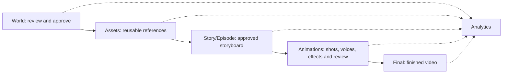

Current phase: **3 - Animation and continuity**. Application version: **0.4.0**.

# Story Studio

Native Flutter Web client with a local FastAPI backend. Existing Python production engines, project manifests, revision history and generated media are retained.

## Start

Requires Python 3.11+, Flutter 3.38+ / Dart 3.10+, and Flutter on PATH. Run from the repository root in PowerShell:

```powershell
# Once: create .venv, install Python packages, resolve Flutter dependencies,
# and generate Dart JSON serializers.
.\scripts\setup.ps1

# Start the API and hosted website (8000, or the next available port).
# Frontend changes automatically regenerate serializers and rebuild Flutter Web.
.\start.cmd
```

In VS Code, open **Terminal > New Terminal** at the repository root and run `.\start.cmd`. This works in PowerShell and Command Prompt without choosing an application for a `.ps1` file. Open the **Story Studio URL printed in the terminal**: the launcher starts at port 8000 and automatically chooses the next available port if it is occupied. Keep the terminal open; press **Ctrl+C** to stop. To start searching at another port, use `.\start.cmd -Port 8001`. The launcher sets PowerShell execution policy for its own process only.

Activation is unnecessary; scripts use `.venv` directly. FFmpeg is provided by `imageio-ffmpeg`, or set `STORY_FFMPEG_PATH`.

The backend watches frontend source, assets and configuration files. It waits briefly for saves to settle, generates Dart serializers, then builds a new release. The last successful release stays available during compilation or if a build fails. Changes made during compilation trigger another build. **Refresh the browser after a successful rebuild** to load the new UI; open pages are kept in place to preserve unsaved edits.

Build status and errors are available at `http://127.0.0.1:8000/api/frontend/status`. Build logs and releases are stored under `storage/temp/frontend-hosting/`. The first build may take a while; an existing compiled build is served while it runs. Watched builds disable Flutter offline caching, and hosted files use `Cache-Control: no-store`.

For Flutter's development server instead, use two terminals:

```powershell
.\scripts\start-backend.ps1 -NoFrontendWatch
.\scripts\start-frontend.ps1
# Open http://127.0.0.1:7357.
```

The client uses same-origin API URLs in the compiled app. Development supplies `API_BASE_URL=http://127.0.0.1:8000` using `--dart-define`. The backend listens on loopback by default.

When starting Uvicorn directly, set `STORY_FRONTEND_WATCH=1` to enable automatic builds. `STORY_FLUTTER_COMMAND` can specify a Flutter executable when it is not on PATH. Multiple rapid edits are combined into one build; build failures wait for the next source change before retrying.

## Production workspace

The app bar provides the current-project dropdown (including **Add project**), a centered workspace name, generation preferences and API keys. The sidebar shows icons for **World, Assets, Story/Episode, Animation, Final and Analytics**; hover to reveal their names. The browser remembers the last opened project, page and selected episode, validates that they still exist at startup, and restores them automatically. An explicit project URL takes precedence.

| Page | Workflow |
| --- | --- |
| World | Settings draft -> AI review -> apply/revert -> immutable approval; reviewed additions remain append-only |
| Assets | Character References: visual, voice and costumes; backgrounds and details; reusable props, SFX, BGM and style rules |
| Story/Episode | Select episode -> Outline -> Story -> Script -> Storyboard approval -> READY TO ANIMATE |
| Animations | Check assets -> Scene images -> Direction & performance -> Animated scenes -> Voices & input -> VFX / SFX -> AI continuity review |
| Final | Timeline/compositing -> subtitles -> mixing/finishing -> assembly -> publish approval |
| Analytics | Generation usage, estimated project costs, provider results and account billing reports |



Pages use native Flutter controls and GetX state/navigation. Workspace actions open immediately, prepare current source/version guards, then submit durable background jobs. Changing pages keeps jobs on the server. Task status, stop-after-current-request, results and errors are available in the task list. Advanced domain operations are searchable under **All workspace actions**. Some specialized editors currently use structured field forms; see [migration status and verification](docs/refactor-status.md) before replacing an established production setup.

## Files and architecture

```text
frontend/                     Flutter Web (GetX)
  lib/<feature>/              controller, model, service, view as needed
  lib/util/                   API client, routes, jobs, shared widgets
backend/
  main.py                     FastAPI entrypoint and compiled-client serving
  routers/                    projects, jobs, media and credential endpoints
  services/                   HTTP adapters and reused story_channel engines
  workers/                    durable SQLite-backed background jobs
  models/                     Pydantic domain models and API requests
  legacy_ui/                  compatibility modules for original regression tests
  requirements.txt            backend runtime dependencies
storage/                      ignored local runtime data
  database/                   jobs.sqlite3 and migration inventory
  uploads/                    incoming browser uploads
  outputs/AI_Story_Channel/   existing project bundle, unchanged internal layout
  temp/                       transient files and short Windows test directories
scripts/                      setup and startup commands
src/story_channel/            compatibility import namespace only
```

**Router -> Service -> Worker:** routers validate HTTP requests; services call the existing production engines; workers run long operations and persist job status in SQLite. Domain rules, provider request tracking and file-based project data remain in the reused engines. SQLite is new for job tracking; the original application had no database to convert.

Storage paths resolve from the project root. Set `STORY_STORAGE_ROOT` to relocate all four buckets. `STORY_DATA_ROOT` can select a specific project bundle. Historical absolute media paths under the former root `AI_Story_Channel` directory are resolved to the relocated bundle without rewriting manifests. Credentials remain in root `.env` (or `STORY_ENV_FILE`); they are not stored in projects or returned to the client.

Project content uses **JSON as the source of truth**, including free-text outlines (`outline.json`, with a `text` field) and history. Images, audio, video and subtitles keep their original formats. Project Markdown is migrated automatically when the project manager starts: existing structured JSON is preserved, text-only documents become JSON, and every original Markdown file is preserved byte-for-byte as text in a checksum-verified JSON archive under `storage/database/markdown-archive/` before removal. README and developer documentation remain Markdown.

Readable Markdown exports are generated on demand without saving duplicate project files: `GET /api/projects/{projectId}/exports/{name}`, for example `exports/scenes.json` downloads a storyboard Markdown file.

To migrate and audit an older configured project bundle manually, run `.\.venv\Scripts\python.exe -m backend.services.project_json_migration` while generation is stopped. The audit checks original file hashes, archived text, remaining Markdown and JSON validity; reports stay under `storage/database/markdown-archive/`.

## Credentials and providers

Open the key icon to replace or clear saved keys. Saved values are masked; blank replacement fields keep existing keys. Opening the dialog checks available account spending/credits. These account totals are separate from estimated per-project generation cost.

| Variable | Service |
| --- | --- |
| `OPENAI_API_KEY` | Text/reviews, scene images, prop visuals and configured OpenAI image operations |
| `OPENAI_ADMIN_KEY` | Optional OpenAI account spending reports |
| `RUNWAYML_API_SECRET` | Configured character/media/video generation and edits |
| `ELEVENLABS_API_KEY` | Voice, SFX and music generation |

Alternatively copy `.env.example` to `.env` once and edit locally. Existing environment values take precedence during startup. All secrets and runtime storage are excluded from Git. **Generation preferences** selects OpenAI text models by process; media models continue to use their dedicated engine configuration. Demo projects use existing offline providers.

## API and checks

Interactive endpoint documentation is at `/docs`. Main resources are `/api/projects`, `/api/projects/{id}/workspace/{page}`, `/api/jobs`, `/api/uploads`, project media, and `/api/settings`. The CLI remains available as `story-channel`; root `pipeline.py` is retained for compatibility.

```powershell
# Focused backend contracts and existing service regression suite.
.\.venv\Scripts\python -m pytest tests/test_fastapi_workspace.py -q --basetemp=storage/temp/api-tests
.\.venv\Scripts\python -m pytest -q --basetemp=storage/temp/test-run

Push-Location frontend
flutter analyze
flutter test
# After changing @JsonSerializable models:
dart run build_runner build
Pop-Location
```

The short test directory avoids Windows MAX_PATH errors in deeply nested revision history. The optional `legacy` dependency group retains Streamlit solely for the original UI and its regression tests; the FastAPI/native Flutter runtime does not require Streamlit. Older documents in `docs/` describe their dated production-engine versions; this README and the migration report describe the current application structure.
