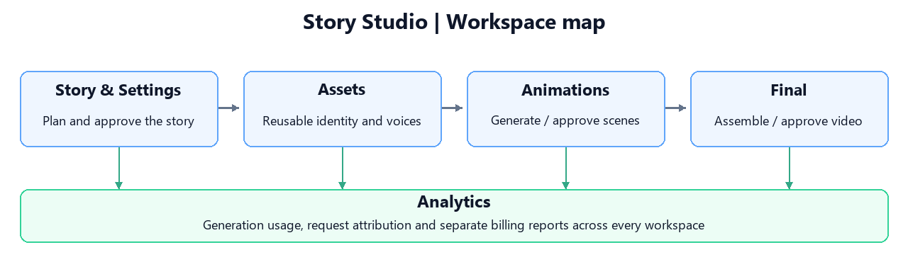
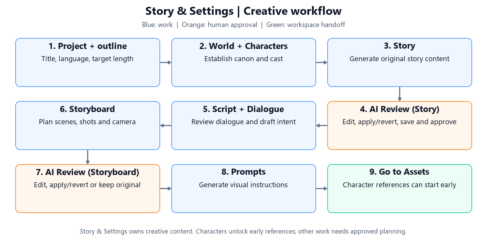
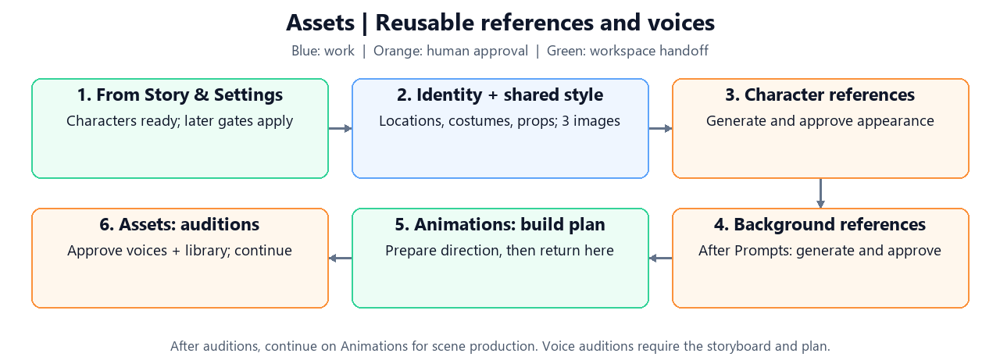
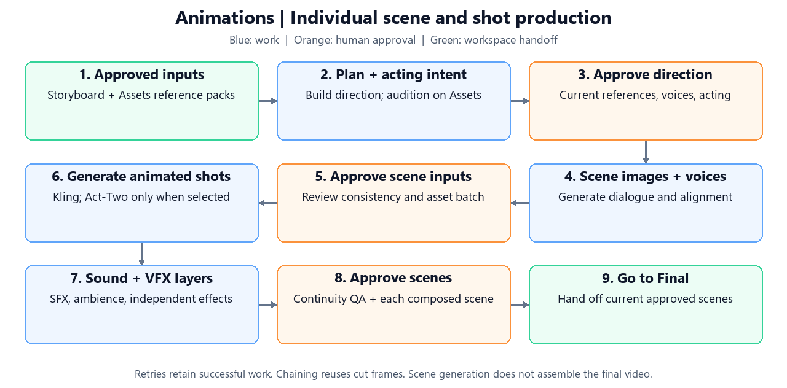
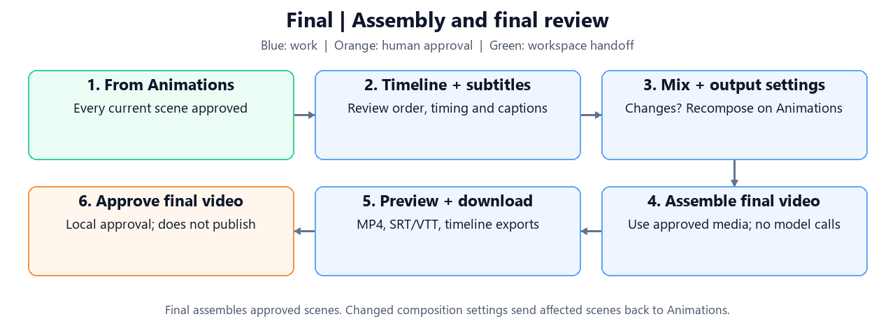
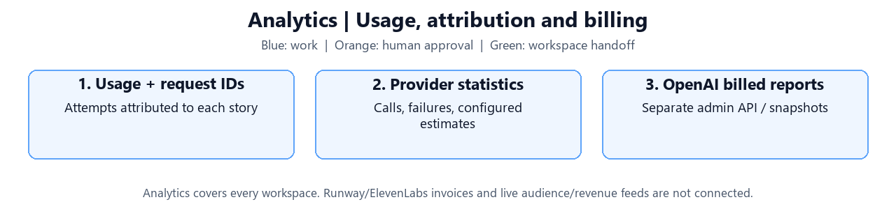

Current phase: **3 — Animation and continuity**.

# Story Studio

Turn an outline into a reviewed story, reusable assets, animated scenes and an approved video. The current specification is **v0.3**; see the [implementation audit and remaining acceptance work](docs/spec-alignment.md).

## Start the app

Requires **Python 3.11+**. Run in PowerShell from this directory:

```powershell
# Once: create an isolated Python environment.
python -m venv .venv

# Install the app and testing tools; -e makes source edits take effect immediately.
.\.venv\Scripts\python -m pip install -e ".[dev]"

# Start the web interface; open the local URL printed in the terminal.
.\.venv\Scripts\python -m streamlit run app.py
```

Activation is unnecessary because commands use the virtual environment directly. FFmpeg is supplied through `imageio-ffmpeg`.

Click the **key icon beside Deploy in the top toolbar** (tooltip: **API key**) to save credentials:

| Key | Purpose |
| --- | --- |
| `OPENAI_API_KEY` | Story, Script, Performance metadata, prompt compilation, typo checks and alignment |
| `RUNWAYML_API_SECRET` | Gen-4 reference images, Kling O3 Pro and selected Act-Two performances |
| `ELEVENLABS_API_KEY` | Eleven v4 voices and generated SFX / ambience |
| `OPENAI_ADMIN_KEY` — optional | OpenAI organization billing reports |

Saved keys show only their first and last four characters; short values stay fully masked. A red hint below each missing key's title says it is not provided. Replacement fields start blank: blank keeps the current key, **Clear** removes it. **Save API keys** writes the local `.env` and updates future requests without restarting. Keys apply across projects; changing them waits for active generation. Sync credentials and controls are removed for now.

Each provider has a dark grey box; both OpenAI keys share one box. Opening the dialog automatically checks all saved providers in parallel; refresh buttons check again. OpenAI shows reported month-to-date spending in USD using the admin key (UTC calendar month). Runway shows remaining credits; ElevenLabs shows used and remaining character quota, period allowance, and reset time. **Spent amounts are red; remaining balances are green.** Account totals apply across projects, reported spending may lag, and each result shows its last check time. Save replacement keys before checking them.

Alternatively, edit `.env` manually and restart. It is plaintext and excluded from Git; existing process environment values take precedence.

```powershell
# Create a settings template only if .env does not already exist.
if (-not (Test-Path .env)) { Copy-Item .env.example .env }

# Edit local credentials and settings.
notepad .env
```

**Demo (offline)** uses sample stories, placeholder images, silent voices and sample timing. Explicit OpenAI actions, including typo checks, modifications and regeneration, still make paid requests in Demo mode.

<a id="workspace-map"></a>
## Workspace map

[](#workspace-map)

| Page | Contents |
| --- | --- |
| [Story & Settings](#story-settings) — default | Project settings, outline, World / Canon, Characters, Story, Script / Dialogue, Storyboard, performance intent and provider preferences |
| [Assets](#assets) | Reusable references, locations, costumes, props, voice profiles / auditions, style, licensed music / SFX and generated image library |
| [Animations](#animations) | Scene / shot direction, performance, scene images, dialogue voices, video, interactions, effects, chaining and scene approval |
| [Final](#final) | Timeline, subtitles, mixing / output settings, assembly, downloads and final approval |
| [Analytics](#analytics) | Generation usage, provider calls / failures, request IDs and billing reports |

**Animations generates individual scenes/shots. Final assembles current approved scenes into a finished video.** Voice auditions live on Assets but currently require the storyboard and animation plan, so return there after preparing direction.

Navigation preserves drafts, selections and background work. Asset stages support **5 simultaneous tasks**. **Stop after running tasks** finishes active work and saves its results/costs, then stops queued work. Other operations wait. Restarting the app stops its workers; saved files and acknowledged remote jobs support recovery.

Every diagram below names its workspace page and handoffs. Click its PNG to jump to that page's instructions. SVG links open scalable diagrams with clickable page handoffs.

<a id="story-settings"></a>
## Story & Settings

[](#story-settings)

[SVG](docs/workflow.svg) · Next: [Assets](#assets) / [Animations](#animations)

1. Create a project with a title, language, outline and target length in **hours / minutes / seconds**. Summaries display **HH:MM:SS**.
2. Under **Generation settings & Providers**, choose OpenAI or Demo and the LLM model. The new default is **GPT-6.1 Sol**; existing projects retain their selected LLM.
3. In **Story workflow**, **Generate next stage: …** runs World → Characters → Story → AI Review (Story) one stage at a time. **Generate / Resume pipeline**, directly below, continues until review decisions and approval are required.
4. Browse **AI Review (Story)**. Compare the original content and editable suggested changes. Choose **Apply change** or **Revert change** for every difference, then **Save and approve**. This includes story approval; there is no separate Human Story approval step. Continue through Script and Storyboard.
5. Browse **AI Review (Storyboard)**. Compare Script and Storyboard with editable dialogue suggestions. Apply or revert every difference, then **Save and approve**, or choose **Remain unchanged and approve** to keep the saved version. Continue to Prompts after approval.

Human approval dialogs show Markdown only by default and create readable `.md` exports for every included content JSON file. Complete duplicate records are shown once: the Character Bible covers matching individual character files. **Show JSON** reveals the source below the Markdown; **Hide JSON** returns to Markdown only. **Project and activity** stays a compact status/version table with brief metadata. Exports refresh from saved JSON without changing approval requirements.

**Browse** shows Markdown before editable output JSON; inputs are read-only. Changes are marked. **Save changes** validates and versions them; **Revert all changes** discards unsaved edits. History stays read-only until **Use revision as draft**. Upstream changes invalidate affected results and approvals.

Click the edit icon beside **Story outline** in the workflow to edit and save it in a dialog. The **Story outline** tab also has an editor and typo check. **Check typos** checks only the corresponding draft; **Apply suggestion** updates it without saving. **Modify (service / model)** accepts a text instruction; **Regenerate (service / model)** creates a new version. Labels identify the service and model the action uses. Save or revert drafts before regeneration/modification.

After Script, **AI Review (Storyboard)** checks dialogue independently. Both AI reviews show original text beside editable suggested changes. **Apply** selects the edited suggestion; **Revert** keeps the original. Editing a suggestion resets its decision. Every difference must be resolved before **Save and approve** is enabled; generation and preview never change canonical content. Saved decisions, original data and rejected suggestions remain in review history. Preparing exact suggestions may make an additional recorded OpenAI request; Demo uses offline placeholders.

In **AI Review (Story)**, **Remain unchanged and approve** keeps the original saved Story and declines all suggestions in one action, including any edited/applied drafts. It requires no individual decisions or additional AI request, and records the declined findings before approving. Existing downstream results and storyboard approval are preserved; Script runs next only if it still needs generation.

Story & Settings reprocesses only the following stages after a saved change:

| Changed content | Must be processed again |
| --- | --- |
| World | Characters → Story → AI Review (Story) → Script → Storyboard → AI Review (Storyboard) → Prompts |
| Characters or Story | AI Review (Story) only |
| AI Review (Story), original Story retained | None after Story approval |
| AI Review (Story), actual Story edits saved | Script → Storyboard → AI Review (Storyboard) → Prompts |
| Script | Storyboard → AI Review (Storyboard) → Prompts |
| Storyboard | AI Review (Storyboard) → Prompts |

Running AI Review alone does not invalidate production results. The review's saved Story changes determine whether Script and subsequent stages need reprocessing. Preserved stages keep their existing data, revisions and approvals across reloads.

**AI Review (Story)** saves accepted Story edits and grants story approval, unlocking Script. **AI Review (Storyboard)** replaces the separate human approval controls. **Save and approve** requires Apply/Revert for every difference; **Remain unchanged and approve**, next to it, declines all pending drafts without an AI request. Approval in this dialog keeps the displayed Storyboard completed and approves it immediately, even when accepted suggestions change Script. Its saved data and revision are retained; no Storyboard regeneration is required. Affected Prompts still need reprocessing. Ordinary Script edits outside this review follow the dependency table above and invalidate Storyboard. Approval remains in the dialog with an Approved status. Source or report changes invalidate old review decisions. **Show JSON** reveals the source below Markdown. Script exports draft performance intent; refine production acting on [Animations](#animations).

<a id="assets"></a>
## Assets

The status table covers every Assets tab, including missing references, registered items, voice setup, baseline/emotion auditions, narrator, shared style, audio library, and reusable images. **Approval**, **Checklist**, and **Next action** show saved review state and remaining requirements; optional items do not block progress. Regeneration selection applies to existing image records; approve references, identities, and voices with their review controls.

Character and background cards include **View / apply saved revisions**. Preview an image, then **Apply revision X** to select it without a generation API call. The flow is **Generate (automatically selects the new revision) or Apply a saved revision → Review → Approve**. Applying never grants approval; the status table shows the selected revision and its approval state. **Stale** means the file is missing/modified or its generation inputs changed, even if an older image is still visible. You can explicitly apply that saved image to the current settings and review it again. Unrelated story or voice-model changes do not invalidate otherwise-current character/background references.

**Regenerate** and recovery of failed/stale image requests use the configured image provider. A saved OpenAI modification does not permanently route new image generation to OpenAI; choose **Modify (OpenAI / …)** explicitly to edit an existing image. Existing successful edited images remain cached until you request a new generation.

[](#assets)

[SVG](docs/assets-workflow.svg) · Next: [Animations](#animations)

Character references unlock after **Characters**. Backgrounds and scene production require the completed creative pipeline, including Prompts and story/storyboard approvals.

1. Choose **Production (configured image / voice providers)** or Demo. Production reference images default to **Runway Gen-4 Image**.
2. Add shared text, **up to 3 style images**, or both. PNG / JPEG / WebP images support **20 MB each**. Uploading replaces the saved selection; remove individual images or clear all.
3. Build the **Identity library** after Characters, preferably before references. The first reference batch creates default registrations if no assets exist yet. Edit stable voice, location, costume and prop data. In **Voice Profiles**, save each character's actual **ElevenLabs Voice ID** (My Voices → ⋯ → Copy voice ID); these fields are available before voice setup. Set the narrator there when needed. OpenAI voice names such as `nova` are not ElevenLabs IDs.
4. Generate and approve character references, then backgrounds. Approve the identity library after its references are ready.
5. **Generate next asset Stage** continues to voice-profile setup and missing baseline auditions after identity approval. **Generate assets until review** runs only work on Assets and stops at manual settings or approvals. Listen and approve in **Voice Profiles**; emotion auditions are optional. Once ready, continue to [Animations](#animations) for acting direction, scene images and dialogue tracks.

The Identity library remembers whether it is expanded across button clicks and workspace navigation. Its status and prerequisite checklist stay visible when collapsed. The checklist distinguishes generated references, registered costumes/props, configured voice IDs, and generated/approved auditions. Costumes are metadata used in reference packs, with no separate costume-image generation. When the next step is **Approve Identity Library**, clicking it opens the library and highlights its approval button. A current approval shows **Approved** and disables the approval button; approval is enabled only when all identity prerequisites are ready.

In **Voice Profiles**, each character and the **Narrator** have an **ⓘ** with ElevenLabs links, a short Voice Design tutorial, and **Generate voice prompt**. OpenAI builds a copyable prompt from character details or the story's narration using the [recommended format](https://elevenlabs.io/docs/eleven-creative/voices/voice-design). Prompts are saved separately; request IDs, usage and costs are recorded. Create and save the voice in ElevenLabs, then paste its Voice ID back here. Voice saves keep the current tab open and show **Saving…**, followed by **Voice saved.**

Production ElevenLabs saves verify new Voice IDs with the saved API key using a [read-only voice lookup](https://elevenlabs.io/docs/api-reference/voices/get). A missing character voice shows **voice id does not exist** below the field and restores the saved ID. Other verification errors preserve the saved voice and keep your draft for retry. No audio is generated by this check; Demo stays offline.

**Play voice** plays the saved character or narrator's existing ElevenLabs library sample, or a current character audition when available. Draft IDs are ignored; playback creates no new speech. If no sample exists, add a preview in ElevenLabs or generate a character audition separately.

Cards show status, revision, preview, style prompt and editable generation details with Save/Revert and typo suggestions. Generate individually, use **Generate next asset Stage: …**, or check rows and **Regenerate selected**. Selected batches stay within one stage. Character references and backgrounds each run **one task at a time**; other asset stages retain the five-task limit. Progress shows the active stage's limit, with additional items queued.

Shared style guides character, background and scene images. Gen-4 accepts three image inputs; larger style/identity input sets become a numbered contact sheet so no supplied reference is silently dropped. Changing references invalidates dependent work; human review determines visual consistency.

**Costumes**, **Props** and **Style References** display registered data; edit it in the Identity library. **Music / SFX library** imports licensed audio with its source. **Reusable generated images** displays saved visuals. Scene images and dialogue-track generation belong on [Animations](#animations).

<a id="animations"></a>
## Animations

**Waiting / generating tasks** shows only the current Animations run. Each press of **Generate next stage** or **Generate animations (pipeline)** clears the previous list and adds the new tasks. It refreshes queued/generating/completed/failed statuses while work runs; stopping marks unfinished tasks as stopped. Completed results stay visible until the next run replaces them. The separate all-stages table remains the overall project checklist.

When the next stage requires approval, click **Next stage: …** to open its tab, expand the relevant section, and scroll to the highlighted review controls. The highlight stays until another button is pressed; clicking the shortcut again restores it.

The top status table tracks scene inputs, direction/performance approvals, shot videos, configured SFX/VFX/lip-sync, scene review and continuity. **Generate next stage: …** runs one generation stage. **Generate animations (pipeline)** runs missing work until settings or human review are required; review buttons open the corresponding tab. Both preserve successful work and recorded costs and support **Stop after running tasks**. Once every required scene and continuity review is approved, continue to Final. The Animations pipeline never approves content or assembles a final video.

**Next stage: Approve generated scenes 3/7** means three of seven current scenes are approved. Review scenes individually in step 5, or click **Approve all scenes** to approve the whole batch. Individual buttons show **Approved** and stay disabled until that scene changes. Every scene must be approved before continuing to Final.

[](#animations)

[SVG](docs/animation-workflow.svg) · Voice auditions: [Assets](#assets) · Next: [Final](#final)

Complete voice casting and auditions on [Assets](#assets), then follow the numbered tabs from left to right:

| Tab | Work | Approval / next step |
| --- | --- | --- |
| **1. Scene images** | Generate images using approved character/location references and shared style | Review images with direction in step 2 |
| **2. Direction & performance** | Edit shots, interactions, camera and dialogue delivery | Approve animation/references and performance direction |
| **3. Voices & input review** | Generate dialogue → align subtitles → run scene-input QA | Listen, inspect timing/images, then approve the input batch |
| **4. Video & effects** | Save video/effect settings, generate shots and configured SFX/VFX | Continue to scene review |
| **5. Scene review & continuity** | Watch scenes and check cuts/identity/voices | Approve continuity when enabled and every scene, then open [Final](#final) |

Production video defaults to Kling O3 Pro (Runway) image-to-video with continuity animation. Local image motion is a preview; OpenAI video remains a legacy option. ElevenLabs generates configured sound/ambience; VFX layers use local transparent effects or selected OpenAI green-screen footage. Sync controls remain removed. Subtitle alignment is generated in step 3; subtitle finishing is on [Final](#final).

For SFX, open **Generated SFX and VFX layers → Edit sound descriptions and timing**. Describe the audible source and action, e.g. “A heavy wooden door closing with a latch click.” Non-English descriptions are translated once per source/model, cached locally and charged to recorded OpenAI usage. Sound-only prompts suppress dialogue and unrelated sounds, with stronger prompt adherence. Default one-shot cues allow up to two seconds; custom durations are preserved. Use looping ambience for continuous backgrounds. Outdated sound prompts appear in the generation checklist; select and regenerate them, listen to the previews, then regenerate affected scene mixes and approve again. Provider output still needs human review.

**Act-Two is selective.** Attach a **3–30 second driving MP4** for an important single-character dialogue close-up, with a clearly visible face and enough duration for the requested clip. Split long or multi-character performances into short individual shots. Changes require fresh approvals; normal shots use Kling.

Kling receives approved first-frame and identity/location references. Compatible shots reuse the previous cut frame. A shot's advanced `lastFrame` field constrains its final generated part to a project-local image. Longer scenes use short cuts; native clip-extension controls are not implemented.

**Retry / regenerate this shot** preserves successful work; chained successors may need regeneration. Saved task IDs resume acknowledged Runway / OpenAI jobs. Oversized Runway prompts use cost-tracked LLM compilation; unknown submission outcomes require explicit inspection/retry instead of automatic duplicate submission.

Video and voice share performance metadata. Eleven v4 uses fixed identity, supported emotion tags and pace; volume and real pauses are applied before alignment. Human listening and visual acceptance remain necessary. See [implementation limits](docs/spec-alignment.md).

<a id="final"></a>
## Final

[](#final)

[SVG](docs/render-workflow.svg) · Changes requiring recomposition: [Animations](#animations)

1. Review **Timeline & Compositing**, **Subtitle**, and **Audio mixing & Visual finishing**. Order follows the storyboard; duration follows recorded voices.
2. Changed mix, subtitle styling or transition settings require recomposing and approving affected scenes on [Animations](#animations). Intact source clips are reused.
3. Under **Outputs & Publish approval**, click **Assemble final video**. Every current scene must be approved. Assembly makes **no generation API calls**.
4. Preview, download, check the review box and **Approve final video**. This records local approval; it does not publish.

Subtitle scenes are collapsed by default and show time intervals. Expand for audio, SRT and timing data; **VTT is download-only**. Subtitles support burned-in, selectable and sidecar output.

Outputs: `output/final.mp4`, `final.srt`, `final.vtt`, `timeline.json` and `final_review.md`. Previous final revisions remain in `output/versions/`. Thumbnail/metadata generation, Shorts, timeline reordering, separate color grading and publishing integration remain pending.

<a id="analytics"></a>
## Analytics

[](#analytics)

[SVG](docs/analytics-workflow.svg) · Scope: [all workspace pages](#workspace-map)

| View | Meaning |
| --- | --- |
| Generation usage / provider calls | Attempts, failures, generation units and configured estimates; USD values use two decimals |
| API request IDs | Requests and remote jobs related to Story Studio projects; missing historical IDs stay empty |
| OpenAI account billed cost | Organization-wide report using the optional admin key; includes other apps/stories and excludes Runway / ElevenLabs bills |
| Assigned billed costs | Saved billing snapshots explicitly assigned to this story, not automatic per-request allocation |

The header's **Project billed cost (USD)** is a rough estimate across this story's recorded providers/models, shown with two decimals. It uses recorded costs first, configured rates second, then approximate default rates. Historical unpriced usage is included automatically; metered retries/failures count, and repeated polls of one generation job count once. Unknown usage is excluded and counted below the total. Demo/local work is free. Account billing reports and assigned snapshots remain separate to avoid double counting.

Default assumptions: OpenAI text $2 input / $10 output per million tokens; images about $0.08 each (Runway turbo $0.02); Runway Kling O3 Pro $0.17/second and Act-Two $0.05/second; ElevenLabs speech $0.08/1,000 characters ($0.04 for turbo/flash); SFX allowance $0.01/second; alignment $0.006/minute. These are rough October 2026 assumptions, excluding tax, subscriptions, discounts, image quality and cache adjustments. Override rates in settings for your account. Sources: [OpenAI](https://developers.openai.com/api/docs/models/gpt-6.1-sol), [Runway](https://docs.dev.runwayml.com/guides/pricing/), [ElevenLabs](https://elevenlabs.io/pricing/api).

**Unknown cost is not free usage.** Missing prices or usage remain Unknown; cached work and approval checks make no model calls. Views, CTR, viewing duration, completion, subscriber conversion, revenue and genre/character/story metrics require future publishing analytics integration. Automated provider quality scoring is also pending.

## Settings and saved files

Defaults: **GPT-6.1 Sol**, **Gen-4 Image**, **Kling O3 Pro**, selective **Act-Two**, **Eleven v4 / ElevenLabs SFX**, **FFmpeg**. See [config.example.json](config.example.json) and [.env.example](.env.example).

| Settings | Purpose |
| --- | --- |
| `dataRoot`, `llmModel`, `llmMaxRetries`, `llmTimeoutSec`, `llmMaxOutputTokens` | Storage and story-generation defaults/limits |
| `imageProvider`, `imageModel`, `ttsProvider`, `ttsModel`, `narratorVoice` | Image and fixed-voice defaults |
| `runwayImageCostPerImage`, `runwayVideoCostPerSecond`, `actTwoCostPerSecond` | Optional model/account-specific Runway estimates |
| `elevenlabsTtsCostPerMillionCharacters`, `sfxCostPerSecond` | Optional ElevenLabs estimates |
| `inputCostPerMillion`, `cachedInputCostPerMillion`, `outputCostPerMillion`, `alignmentCostPerMinute` | Optional OpenAI token/alignment estimates |
| `renderTimeoutSec`, `ffmpegPath` | Render/job timeout and optional FFmpeg executable |

Each setting has a `STORY_` environment equivalent: `llmModel` → `STORY_LLM_MODEL`. Precedence: defaults → JSON config → local `.env` → existing environment → CLI flags. The app loads `.env` from the working directory. Keep secrets out of project JSON; old OpenAI media rates are separate from new provider rates.

Default project path: `AI_Story_Channel/03_stories/<projectId>/`.

| Files | Workspace |
| --- | --- |
| `manifest.json`, `outline.md`, creative JSON/Markdown, `prompts/` | Story & Settings |
| `identity_library.json`, voice/location/costume/prop exports, `references/style/` | Assets |
| `production.json`, `animation.json`, `animation_plan.json`, `finishing.json`, media folders | Assets / Animations |
| `render.json`, `music_plan.json`, `output/` | Animations / Final |
| `usage.json`, `requests.jsonl`, logs; workspace billing allocations | Analytics |
| `history/` | Saved revisions across the workflow |

Canonical edits invalidate dependent results and approvals. Missing/modified files become stale; Resume reuses intact work. History retains previous versions. Shared world/character libraries live outside each story.

## CLI and development

Global CLI options go **before** the command. Replace `YOUR_PROJECT_ID` with the ID printed during creation.

```powershell
# Create a project; CLI duration is in seconds.
.\.venv\Scripts\story-channel create input/story_outline.md --title "The Last Lighthouse" --language zh-TW --duration 600

# Generate sample creative content until story approval is required.
.\.venv\Scripts\story-channel run YOUR_PROJECT_ID --demo

# Record story approval, then continue to the storyboard gate.
.\.venv\Scripts\story-channel approve YOUR_PROJECT_ID story
.\.venv\Scripts\story-channel resume YOUR_PROJECT_ID

# Record storyboard approval, then generate remaining prompts.
.\.venv\Scripts\story-channel approve YOUR_PROJECT_ID storyboard
.\.venv\Scripts\story-channel resume YOUR_PROJECT_ID
```

`run` and `resume` are equivalent and remember the provider. On a new project, omit `--demo` to use the configured production LLM; existing projects keep their selected mode.

| Command after `story-channel` | Purpose |
| --- | --- |
| `list` / `show YOUR_PROJECT_ID` | List projects / inspect state |
| `generate YOUR_PROJECT_ID script` | Generate one creative stage |
| `regenerate YOUR_PROJECT_ID script` | Force a revision and invalidate downstream work |
| `edit YOUR_PROJECT_ID story edited_story.json` | Validate and import canonical JSON |
| `dialogue-review YOUR_PROJECT_ID` | Review script dialogue |
| `identity YOUR_PROJECT_ID prepare` | Build reusable identities |
| `assets YOUR_PROJECT_ID show` | Inspect asset stages and subjects |
| `animation YOUR_PROJECT_ID prepare` | Build direction after storyboard approval |
| `render YOUR_PROJECT_ID show` | Inspect rendering after asset approval |
| `schemas docs/schemas --production` | Export creative/production JSON contracts |

**Legacy CLI distinction:** `render YOUR_PROJECT_ID run` generates scenes and can assemble automatically once its gates pass. The **UI** uses separate scene approval and **Assemble final video** actions; use it for the workspace flow above.

```powershell
# Inspect CLI options without generating content.
.\.venv\Scripts\story-channel --help

# Run automated checks with mocked providers and real local media encoding; no paid API calls.
.\.venv\Scripts\python -m pytest

# Rebuild page-labeled PNG diagrams and clickable SVG sources.
.\.venv\Scripts\python docs/generate_workflows.py
```

Real-provider identity, acting, voice and cinematic continuity quality still require human acceptance. See the [specification audit](docs/spec-alignment.md).
