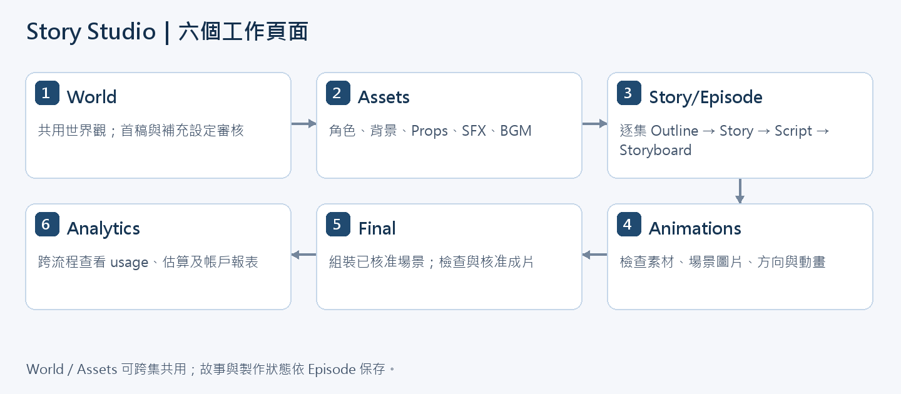
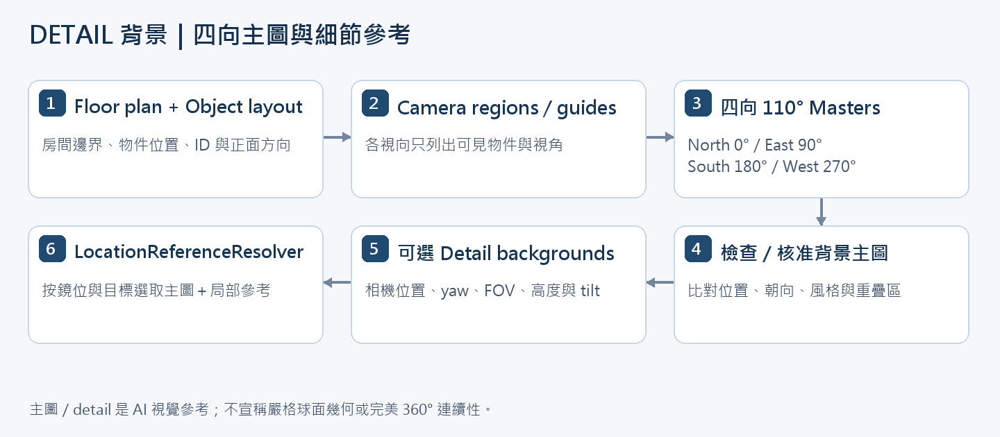
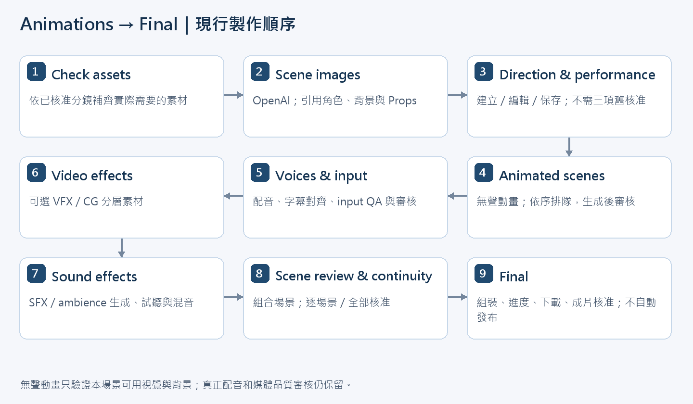

# AI 故事影音自動化系統－技術開發規格書

Story Studio｜依現行程式修訂版

文件版本：v0.4｜修訂日期：2026-11-06｜程式套件版本：0.4.0

目前開發範圍：Phase 0～3。Phase 3 的製作流程已實作；真實供應商的角色、表演、聲音與連續性品質仍須驗收。

本文件依目前工作目錄的程式與使用者已確認的操作流程整理，包含尚未提交的工作內容；不代表另一個已發布版本。本文描述現行行為，沒有執行付費生成、變更既有專案核准或修改使用者媒體。

## 1. 文件目的與修訂原則

系統以「World 共用世界觀與資產、多集 Story/Episode 獨立製作、Animations 逐場景生成、Final 組合成片」為主軸。人類保留內容選擇與成片品質判斷；AI 處理故事、素材、表演方向與媒體生成；所有重要結果保存於本機並可追溯。

本版取代舊 v0.3 對頁面、背景流程、模型用途及核准關卡的描述。原規格中的長期目標保留在後續 Roadmap，不視為現行功能。供應商與模型名稱是程式設定／Adapter 的實作值，不是對帳號可用模型、價格、服務品質或供應商未來政策的保證。

三項資料原則：
- 核心資料使用穩定 ID 與 Pydantic JSON Schema；Markdown、圖片、音訊、影片是可閱讀或可播放的產物。
- World 與 Assets 可跨集共用；每集的故事、分鏡、生成狀態、成本歸屬與成片獨立管理。
- 「資料存在」、「目前輸入有效」、「已選用版本」和「人工核准」是不同狀態，不以單一 approved=true 代表所有階段。

## 2. 系統架構

| 層級 | 現行責任 | 主要技術／儲存 |
| --- | --- | --- |
| UI | 六個工作頁面、對話框、逐項編輯、局部更新、排隊與預覽 | Streamlit；具名 fragment 與 Session State |
| Application services | World、Episode、Assets、Animations、Final 的流程與依賴控制 | Python；各服務方法與工作佇列 |
| Creative | Outline、Story、Script、Storyboard、文字審稿與內部 Prompt 編譯 | Structured Output、Pydantic、JSON／Markdown |
| Shared asset / identity | 角色視覺、聲線、服裝、背景、細節背景、道具、SFX、BGM、Style rules | 本機素材庫、revision、穩定 ID |
| Animation / performance | Shot plan、逐句表演資料、場景動畫、連續幀與聲音處理 | AnimationDirector、SceneProduction、Provider adapters |
| Production / finishing | 字幕、配音、音效、VFX、場景合成、Final assembly | FFmpeg、影音 Adapter |
| Observability | Request ID、usage、費用估算、錯誤回應、來源與版本 | manifest、production、usage、requests、error_reports |



流程圖中的順序是主要依賴關係。Assets 可持續增加並供不同集數使用；Analytics 可隨時查看；Final 僅使用已完成必要審核的場景媒體。

## 3. 工作頁面與入口

| 頁面 | 分頁／內容 | 完成後的主要用途 |
| --- | --- | --- |
| World | 世界觀名稱、預設語言、首稿設定、AI Review、已核准／待核准補充設定 | 提供所有角色與集數的共用規則 |
| Assets | Character References、Background、SFX、BGM、Props、Style check | 共用素材與一致性來源 |
| Story/Episode | 集數清單；Outline、Story、Script、Storyboard | 分鏡核准後 READY TO ANIMATE |
| Animations | 集數清單；Check assets、Scene images、Direction & performance、Animated scenes、Voices & input、Video effects、Sound effects、Scene review & continuity | 產生可供 Final 使用的場景 |
| Final | 合成／輸出設定、時間軸相關資料、字幕與混音、最終組裝、下載、成片核准 | 產出可人工檢查與使用的影片檔 |
| Analytics | 專案 usage／估算成本、Provider 統計、Request 歸屬、OpenAI 帳戶費用 | 檢視製作成本與失敗／重試情況 |

新 World 專案只需先填世界觀，不必先寫一集故事。World 核准後才解鎖後續製作。切換頁面與集數保留支援的草稿、展開狀態及背景工作，不取消正在執行的 API 請求。

集數清單由最新建立到最早建立排列。Story/Episode 清單顯示故事製作狀態，Animations 清單顯示動畫製作狀態。下一步提示必須標明所屬頁面與具體工作。

## 4. World：共用世界觀

### 4.1 首稿欄位

| 項目 | 應填內容 | 範例方向 |
| --- | --- | --- |
| 世界觀名稱 | 可隨時修改的識別名稱 | 海港記事 |
| 預設語言 | 後續內容與語音示例採用的語言 | 繁體中文 |
| 核心前提 | 故事世界最重要的一至兩句定義 | 人類依賴記憶燈塔抵抗遺忘 |
| 時代與環境 | 年代、地理或生活環境 | 近未來的沿海城市 |
| 核心規則 | 世界運作、代價與因果 | 記憶只能轉移，不能憑空製造 |
| 科技／魔法與限制 | 能做到與不能做到的事 | 燈塔需要實體能源，不能復活死者 |
| 社會與關鍵場所 | 影響角色行動的社會背景與地點 | 港口由自治議會管理 |
| 調性 | 喜劇／懸疑等敘事與表現方向 | 溫暖、微懸疑、避免血腥 |
| 禁止矛盾 | 不可被後續故事推翻的事項 | 未設定的超能力不得臨時解決衝突 |

每項可先以簡短描述填寫；未知細節不必一次補齊。機構、歷史與完整時間線可之後補充。

### 4.2 首稿與補充設定流程

首稿：編輯 → AI Review → 套用／保留建議（可手動編輯）→ Approve。

核准後，世界觀正文不可直接修改；可新增補充設定。補充設定：草稿 → AI Review 檢查與基底／已核准補充的矛盾 → 套用／保留／編輯 → Approve。待核准補充可修改或刪除；核准後僅追加，不可移除或覆寫。

World 名稱仍可修改。現行主要儲存檔是 world_setting.json；不另外維護 world_settings.md。world_base.json、world.json 是供製作使用的衍生資料。核准後的內容以閱讀形式顯示，各要點採粗體標題。

既有 Episode 保存其 World 快照；採納新的已核准補充應經既有更新流程，不把新的世界設定默默套入已完成的集數。

## 5. Assets：可重用素材庫

### 5.1 前置條件與 Style rules

Assets 的基本前置條件是至少一個角色定義與一個背景定義，不再要求「完成整個 Assets 階段」。SFX、BGM、Props、Style check 可選；當分鏡實際使用它們時，Check assets 再要求對應檔案存在且可用。

Style rules 區塊放在素材分頁上方，提供共用文字規則與可選風格參考圖。各素材的身分／布局參考、文字 Prompt、設計參考與純風格參考須標記用途，避免把風格參考中的人物或家具誤當成指定內容。Style check 以新增／變更素材為檢查目標，既有素材作對照。

### 5.2 Character References

每個角色是一個可展開項目，標頭顯示名稱與狀態。角色內有 Visual、Voice、Costumes 三個分頁；已核准角色預設收合，待處理角色預設展開。上方顯示角色總數。

- AI Generate characters 區塊只在尚無角色時顯示；Add character 預設收合，可輸入 Prompt 並由 AI 新增與 World 一致的角色。
- Generate all Visual (Text) 依各角色文字 Prompt 建立 model sheet。生成區可切換文字或圖片模式，顯示實際採用的 Prompt 或參考圖。
- 文字模式的視覺資訊以年齡、外貌、服裝及影響外觀的性格／不可變特徵為主，避免無關背景故事占用 Prompt。
- 圖片模式可使用上傳的設計參考，或先用 OpenAI 產生 1024×1024 的單一角色正面設計圖，再用作 model sheet 的參考。
- Character detail 採緊湊、分框欄位呈現。Edit mode 可編輯欄位，但 characterId 不可修改；Edit reference 可獨立使用。
- Visual、Voice、Costumes 可瀏覽及套用各自保存的 revision；預覽不改變目前選用版本。角色視覺歷史可刪除，剩餘 revision 依既有規則連續編號。
- 刪除角色受到使用／核准限制；已用於故事、劇本或動畫的角色不可任意破壞引用。

Voice 保存實際供應商 Voice ID、年齡感、音域、口音、說話風格與基礎情緒。儲存時驗證 Voice ID，無效時在欄位下提示並回復已儲存值。可試聽供應商範例、產生不同情緒示例與不超過 3 秒的 talking animation sample；聲音示例語言跟隨設定。AI voice-design Prompt 限制在 500 字元內。

Costumes 可新增／編輯服裝資料並生成服裝 model sheet；每個服裝項目可收合。完整 Approve character 仍要求 Visual、Voice、Costumes 符合角色素材頁的完成條件；未完成時顯示缺項。這個完整角色核准不等於每一個無聲動畫的必要條件，詳見第 8 節。

### 5.3 Background：DETAIL 與 SIMPLE

| 類型 | 草稿與主要資料 | 產出 |
| --- | --- | --- |
| DETAIL | 名稱、描述、floor plan、object layout、camera guides、風格規則 | 四向主參考圖及可選 detail backgrounds |
| SIMPLE | 名稱／描述或 Detail prompt，可選圖片引導 | 一張主背景圖 |

背景標頭顯示「名稱 · 較小字體的 background ID · 狀態」。可編輯描述、個別核准／刪除背景，或以 Approve all backgrounds 核准待處理背景。

現行 DETAIL 主流程為：floor plan + object layout → 各視向 camera region → 四向主圖（North、East、South、West）→ 可選細節背景 → LocationReferenceResolver。不是舊的兩張主圖、獨立八向 yaw 重新生成、橋接圖或單張真正 360° 全景保證流程。

| 主圖名稱 | 內部名稱 | 中心 yaw | 水平 FOV | 輸出目標 |
| --- | --- | --- | --- | --- |
| North | front_panorama / master_north | 0° | 110° | 2560×1440 |
| East | east_panorama / master_east | 90° | 110° | 2560×1440 |
| South | back_panorama / master_south | 180° | 110° | 2560×1440 |
| West | west_panorama / master_west | 270° | 110° | 2560×1440 |

內部名稱保留 panorama 是相容性命名；不能據此宣稱它是物理精確的球面全景。主圖是 AI 參考素材，需檢查重疊區、物件朝向與空間一致性。



Floor-plan images & camera guides 放在 Floor plan, object layout & reference settings 區塊。Visible floor plan 顯示整體配置；各 camera guide 顯示相機位置、方向、可見區域與 FOV。物件使用穩定 ID；object layout 包含 facing direction，平面圖以箭頭表示正面。

AI 生成 floor plan/object layout 時一併產生朝向資訊。可手動編輯，也可用 Prompt 修改 object layout；Check reference 用於比對配置與布局。相關修改操作會保存資料，不再依賴獨立 Save reference setting 按鈕。可預覽／套用 floor-plan revisions。主圖生成以前須有目前可用的平面圖與 camera guides。

主圖 Prompt 僅包含該 camera region 可見的物件，使用穩定物件 ID、固定位置／朝向、材質、光線與共用風格，禁止人物、複製物件或任意改變家具方向。鄰近主圖及重疊區提供視覺連續性參考，但不保證 AI 絕不漂移。

### 5.4 Detail backgrounds

每個 detail background 使用穩定 detailId，隸屬一個 locationId，用於桌面、窗邊、入口等局部鏡位。Add detail background 先建立草稿；草稿成立後才 Generate detail。Prompt 保存在該草稿框內；新增後清空新增欄位。

Camera setup 在 floor plan 上按下並拖曳設定相機位置與方向，以扇形顯示 FOV；另可調整高度與 tilt，並提供 reset。保存後載入最後一次儲存的相機姿態。生成會將相機姿態與可見物件投影／畫面位置資訊加入引導，避免只照搬主圖構圖。

生成參考選用最適合的方向主圖、必要鄰向參考、Style rules 與當前 camera/layout metadata。現行請求尺寸為 1536×864；正式 Provider 回傳低於 1280×720 時拒絕套用，不以放大冒充高解析度。

生成圖片顯示在 Generate detail 下方。Zoom 對話框以拖曳矩形指定局部放大範圍；確認後重新生成並補細節。生成／Zoom 過程以 loading indicator 與 Generating... 取代圖片區；失敗顯示原因及 Error Report。

細節背景的修改不重新要求整個背景核准；主圖變動才使背景核准失效。只有已產生且有效的 detail 圖片可供動畫選用。刪除 detail 須在對話框輸入 detailId 確認。

### 5.5 Props、SFX、BGM 與 Style check

| 類別 | 現行操作 | 重要規則 |
| --- | --- | --- |
| Props | 新增／編輯資料、不同 mode、OpenAI 圖片、revision 預覽／套用、跨 mode 套用、刪除 | 圖片為乾淨白底，只顯示道具；描述僅寫視覺。整個 prop 刪除須輸入名稱；mode 刪除須確認 |
| SFX | 收合卡片、名稱／聲音描述、上傳、ElevenLabs 生成、播放器、缺漏項目批次生成 | 描述僅描述聲音，避免生成說話；合理時長與循環設定；0.5～30 秒 |
| BGM | 上傳、ElevenLabs music、Pixabay 選曲／AI 選曲入口、播放器 | 保存來源與可取得的授權證據；生成時長 3～600 秒；系統記錄不能取代人工確認實際使用權限 |
| Style check | 比對新增／變更角色與背景、列出不協調項目 | 超過五項不協調時建議重建；屬可選 QA，不是完整 Assets 核准關卡 |

素材存在但不在任何場景使用時，不應迫使每集完成該素材。分鏡 AI 應盡量重用既有素材，必要時才新增最少量的背景、細節背景、props、SFX 或 BGM 要求。

## 6. Story/Episode：每集獨立製作

Outline 上方固定顯示集數清單，下面只顯示所選集數的內容。每集有 title、outline、target duration（HH:MM:SS）。刪除集數須輸入完整標題確認。

| 分頁 | 功能 | 進入下一步 |
| --- | --- | --- |
| Outline | 編輯本集大綱／長度、AI Review、Modify with prompt | 儲存並核准大綱 |
| Story | Hook、Setup、Conflict、Escalation、Twist、Climax、Ending | AI Review (Story) 中完成選擇並核准 |
| Script | narration、dialogue、action、duration、audio tags | 生成／編輯／review 後核准 |
| Storyboard | 逐場景畫面、動作、鏡頭、背景／detail、角色、道具、BGM、SFX | 儲存及核准後自動準備內部 Prompts |

獨立 Prompts 分頁與 Prompt 人工核准已移除。Storyboard 核准後以本機 deterministic compiler 產生內部 image/video prompt artifacts，完成後狀態為 READY TO ANIMATE；這個準備步驟不額外呼叫文字 LLM。失敗時保留分鏡核准並提供準備重試入口。

### 6.1 AI Review 的差異與核准

AI Review 顯示原始內容與建議修改。逐項 Apply／Revert，可手動編輯；必要差異都已選擇後才 Save and approve。Remain unchanged and approve 可直接採用原始版本，不必逐項處理建議。

審稿報告本身不自動改寫原文。AI Review (Story) 已包含原先 Human story approval；AI Review (Storyboard) 取代原先 Human storyboard approval。適用的 dialog 優先顯示可閱讀內容，JSON 以 Show JSON／Hide JSON 切換；重複資料不重複展示。

### 6.2 分鏡逐場景操作

場景卡收合時顯示「Scene ID · shot type · 起訖時間（duration）」及 action description，不以 Item 1、Item 2 作無意義標題。對話中每位角色的發言分行，Markdown 適度換行。

每個場景可獨立再生成、編輯與保存；可 Split scene、Remove scene，或在最前／中間／最後新增場景。新增與分割對話框接收 Prompt；完成後依順序重新編號，保留未受影響場景的內容。結構修改仍屬 Story/Episode 的正常儲存／重新核准流程。

背景選單同時包含 parent location 與已生成 detail background。顯示格式為 backgroundId（名稱）；detail 顯示 backgroundId（名稱 · detailId）。儲存時核心 scene 仍使用 locationId + targetArea，而不是把顯示字串當作 ID。

可在場景內以簡短描述新增背景、Prop、BGM 要求。已存在素材與待生成要求以不同顏色／標籤辨識；保存後同步到共用 Assets。SFX 描述限定聲音、Prop 描述限定外觀；新 SFX 依用途設定合理時長。

### 6.3 最小必要失效範圍

| 修改來源 | 應重新處理的創作階段 |
| --- | --- |
| World 核准前的內容／明確採納的新 World 版本 | 受影響 Episode 的 Characters／Story／Review／Script／Storyboard／內部 Prompt 依依賴更新 |
| Characters 或 Story | AI Review (Story)；若審稿實際改動故事，再使 Script 與其後資料失效 |
| AI Review (Story) 選 Remain unchanged | 不因審稿動作本身使後續內容失效 |
| AI Review (Story) 改動 Story | Script、Storyboard、分鏡審稿與內部 Prompt |
| Script | Storyboard、分鏡審稿與內部 Prompt |
| Storyboard | 分鏡核准／內部 Prompt 與受影響製作輸入；審稿後核准的 Storyboard 本身保持完成 |

上述是依賴政策，不代表刪除既有媒體。素材或輸入 hash 不一致時將既有結果標為 stale，供使用者重新生成或明確套用舊 revision。

## 7. Animations：場景與鏡頭製作



Animations 先選集數。Check assets 的前提是本集 Storyboard 已核准；後續生成還會驗證內部 Prompt 與實際素材是否可用。分頁由左至右依製作順序排列。

### 7.1 Check assets

依目前 Storyboard 列出 Background（parent 與 detail 各自一列）、Props／mode、BGM、SFX。相同素材重複使用時合併場景清單。已有檔案使用綠色標示，不存在使用紅色；可展開項目的標題也顯示綠／紅點。

Checklist 與 Assets 共用同一組來源。此頁的描述、上傳、生成與選用修改須同步到 Assets。需要新增／修改的背景及 Prop 草稿顯示在對應清單下方，預設收合；SFX／BGM 使用與 Assets 相同的可播放素材卡。

本頁不再有額外素材核准程序。依既有規則檢查檔案存在且有效後，即視為該 requirement 已完成。Generate all 類按鈕只生成缺漏素材，不重複生成已存在項目。若刪除某場景的 Prop 依賴，須適度調整分鏡文字以保持情節，並使 Story/Episode 的 Storyboard 重新進入核准流程。

### 7.2 Scene images

使用 OpenAI GPT Image 2.5 Sunburst 生成場景圖片。請求必須附帶 Assets 中實際使用的角色 model sheets、背景／detail、必要 Prop 圖片；風格圖僅提供風格，不能取代角色身分參考。

每張卡片顯示 visual description、shot type · duration、action，以及圖片、狀態與 revision。可個別 Generate／Retry／Regenerate、Modify、下載、瀏覽與套用保存 revision。套用 revision 不呼叫生成 API；套回舊版後下一次生成仍採全歷史最大 revision + 1。

每張卡片內有本場景 Storyboard 編輯器。提交的有效欄位修改自動保存、保留分鏡核准並立即更新內部 Prompt，可直接再生成並前往下一場景；這是 Animations 局部編輯的特例，不改變 Story/Episode 全分鏡編輯器的審核流程。無效草稿保留並顯示錯誤，禁止以未保存草稿生成。

stale 表示目前輸入與圖片生成時不同，不等於檔案遺失。例如 visual description、action、camera、reference revision 或生成參數改變。可用新輸入再生成，或明確 Apply 舊 revision 承認其為目前選用結果；預覽不會自動承認。

### 7.3 Direction & performance

建立 Animation plan，保存 Shot action、camera、start/end pose、interaction target、costume/prop IDs、chaining，以及逐句 Performance metadata。

Performance 資料包含 emotion、intensity、pace、volume、pauseBefore／pauseAfter、subtext、audioTags、gesture、facialExpression、bodyAction、eyeDirection、cameraReaction、sfxCue 等。核心資料仍保留原 dialogue text、speaker、scene／shot ID 與順序；修改台詞應回到 Storyboard。

使用者可閱讀、直接編輯、保存，或選擇 Generate direction、AI review、Modify with prompt 取得可編輯建議。建議未保存前不影響目前計畫。

已移除三項人工 Gate：Approve animation and references、Approve dialogue / performance direction，以及逐場景方向核准。只要已有目前有效且完整的方向／表演計畫，就可前往 Animated scenes。舊 approval 欄位保留相容既有檔案，但不作現行方向生成關卡。

展開／收合場景及編輯方向欄位只更新該卡片，不重新整理整個 Animations 頁面；單純瀏覽不呼叫 AI。

### 7.4 Animated scenes

本階段把目前場景圖片與保存的 direction/performance 轉為無聲動畫。一般使用 Runway 提供的 Kling O3 Pro；重要單角色情緒近景可明確指定 Act-Two 與上傳的 driving video。Local 模式是 FFmpeg 圖片動態預覽，不能等同真實角色表演。

Video settings 位於上方，可局部展開／收合。下面有 Generate all animated scenes，依 scene.order 升冪建立生成佇列；會生成或再生成所有可處理場景，跳過已 running／queued 與未保存方向草稿。此按鈕與 Check assets 的「只補缺漏」批次按鈕意義不同。

每個場景保持獨立卡片：按下 Generate 後立即把按鈕改為 Generating…，影片區顯示 loading icon 與 Generating...；排隊顯示 Queuing…。其他場景可繼續閱讀／編輯方向或排隊。單一專案的影片與方向寫入採序列化保護；不為顯示動畫而重建整頁。失敗保留已完成片段／前一版本並提供 Error Report。

#### 無聲動畫的必要條件

| 檢查 | 現行規則 |
| --- | --- |
| 分鏡／方向 | 使用目前完整的 storyboard／animation plan；不需三項已移除方向核准 |
| Scene image | 目前選用圖片必須有效且檔案完整；stale 時先生成或套用版本 |
| Character visual | 只檢查本場景使用的角色；model sheet 必須 current 且完整，scene image 的 reference hash 須對得上 |
| Background | 本場景使用的背景須符合背景核准與檔案規則；不以無關背景的整庫狀態阻擋 |
| 完整角色核准 | 不因缺少獨立 costume sheet、其他情緒試聽或完整角色總核准而阻擋已有有效視覺的無聲片段 |
| 無角色鏡頭 | 不要求角色 approval 或 voice preview；仍驗證背景、方向與場景圖片 |

這項放寬只適用無聲動畫的視覺生成，沒有把任何角色或聲音自動標為核准。後續真正配音仍驗證 Voice ID、聲線與必要試聽；場景影片、場景合成、連續性與 Final 也保留各自媒體審核。

場景動畫生成後可預覽、下載、再生成並 Approve animated scene；這是媒體品質審核，與已移除的 direction approval 不同。方向、圖像或輸出設定變更後，既有動畫依 hash 變為過期，需再生成／檢查。

每個 animated scene 可瀏覽／預覽／套用保存的影片 revision。預覽不變更目前選用片段；套用不呼叫 API，會重新要求影片核准。套回舊版後再生成仍採歷史最大 revision + 1。

Modify animated scene 開啟可播放、暫停與拖曳時間的對話框。使用者在影片上框選固定矩形，亦可拖動選框，再輸入替換 Prompt。系統將該區域的影片裁切後交給 Runway Aleph 2.0（aleph2）video-to-video，最後以 FFmpeg 疊回原影片；選框外使用原始影像，不把整張畫面交由 AI 自由改寫。這是固定螢幕座標的局部替換，沒有物件追蹤。

Aleph 輸入採 2～30 秒、最高 30 FPS。短片暫時補到兩秒，回傳後裁回原長度；長場景切段處理。生成成功才產生並套用新 revision，同時保存來源、選區、實際 Prompt、Provider job 與 usage；失敗保留原片與原核准。雙比例輸出由修改後主片重新建立直向版本。這項實作已以本機／mock 驗證，尚未執行真實付費內容品質驗收。

### 7.5 Voices & input、Video effects、Sound effects

Voices & input 在動畫片段完成並核准後，生成角色對白／旁白、字幕對齊與 input QA。以實際 Voice ID 固定聲線，將支援的音訊 tags、pace、volume 與停頓帶入處理；不能保證語意表演必然符合劇情，仍須聆聽。

SRT／VTT 與 timing 資料由聲音對齊產生。字幕 UI 按場景收合、顯示時間區間；VTT 僅下載，不直接展示整個原始檔。完成 input QA 後保留 scene-input 媒體核准。

Video effects 以獨立圖層／合成資料處理雨、煙、粒子等現有效果；不是已完成所有電影級 CG。Sound effects 可調描述與時長、生成／重試及試聽。SFX、BGM、Dialogue 分軌保存並混音。

現行核心不要求 Sync lip-sync；SYNC_API_KEY 與該設定 UI 已移除。舊 Adapter／歷史資料只為相容保留，不能宣稱已提供目前可操作的 Sync 後處理流程。

### 7.6 Scene review & continuity

把核准的無聲片段與聲音、字幕、BGM、SFX／VFX 組合成場景。視覺可依配音長度調整時間，不因合成必然再呼叫 Video API。逐場景檢查臉、服裝、空間、動作、聲音、節奏與切點。

支援逐場景核准與 Approve all scenes；進度顯示已核准／總數，例如 3/7。核准按鈕改為 Approved 並停用，只有內容更新後才重新開放審核。尚未核准所有必要場景以前不能完成 Final assembly。

相容相鄰鏡頭可使用上一個 Shot 的尾幀作下一個起點；orbit 按較小角度段拆分，動作重疊於組裝時裁切。這是 reference／chaining 策略，不是無條件保證 AI 的跨鏡頭幾何一致性。

## 8. Final、輸出格式與 Analytics

### 8.1 Final

Final 將已核准場景組成完成影片，不負責重新生成個別場景。Assemble final video 顯示 loading、目前處理步驟與百分比；可檢查並下載影片、字幕及 timeline 等實際產物，最後進行成片核准。核准不會自動發布。

輸出設定包含 resolution、FPS、轉場、字幕呈現、音量、ducking、normalization 等既有合成功能。現有 FFmpeg 工作流不等於專業 NLE 時間軸編輯器、完整調色或任意多軌特效編輯器。

### 8.2 Portrait／Landscape

支援 landscape、portrait、兩者。雙格式先產生 landscape，再本機裁切 portrait；重要人臉、對白動作與關鍵道具應放在 portrait-safe 中央區。這是共用同段影片的雙輸出，不是獨立重拍或智慧重剪 Shorts。

單獨 portrait 使用直向輸入／輸出設定。切換格式或影響內容的 video settings 後，受影響的場景需重新產生／檢查。後續自動長片選段與多支 Shorts 策略仍屬 Roadmap。

### 8.3 Analytics 與成本

| 項目 | 現行意義 |
| --- | --- |
| Project billed cost (USD) | UI 名稱；實際為依已記錄 usage、已知費用、設定單價及 fallback rates 加總的粗估，不是各平台發票總額 |
| World 專案彙總 | 包含共用資產與所屬集數，對相同遠端 job 去重 |
| Request / usage 歸屬 | 記錄實際發出呼叫的 Story Studio World／Episode ID、Provider、model、Request／task ID |
| OpenAI 帳戶費用 | OPENAI_ADMIN_KEY 取得的帳戶層級報表，與專案粗估分開呈現；不能僅憑 Request ID 變成精確逐專案帳單 |
| 失敗／重試成本 | 有可用計量時記錄；缺少供應商 usage 時不能假設免費或精確已知 |
| 顯示格式 | USD 金額以小數二位顯示；底層保留精度，0.00 可能是四捨五入或資料不足，須看 usage／Unknown 狀態 |
| 觀眾成效 | Views、CTR、觀看時長、完播率、訂閱與收入尚無已連接的正式資料來源，不視為完成的自動分析 |

API key dialog 顯示 OpenAI 本月 reported spending，並以較小文字顯示上月 spending；不再要求 fallback monthly budget。Runway 顯示可取得的剩餘 credits；ElevenLabs 顯示已用／剩餘配額。消耗顯示紅色、剩餘顯示綠色，並標示查詢時間與不可取得狀態。

## 9. Provider 與模型分工

| 用途 | 現行主要 Adapter／model ID | 憑證 |
| --- | --- | --- |
| World／Outline／Story／Script／Review／Performance 等文字 | OpenAI；Balance 預設 gpt-6.1-sol，metadata 可用 gpt-6-luna | OPENAI_API_KEY |
| 可選文字模型 | gpt-6-astra、gpt-6-luna、gpt-5.6-sol；依 Generation preferences 的 process 設定 | OPENAI_API_KEY |
| 角色 model sheet、正面 design reference、服裝／Props 圖片 | OpenAI gpt-image-2.5-flare | OPENAI_API_KEY |
| 背景主圖與 detail | OpenAI gpt-image-2.5-flare | OPENAI_API_KEY |
| Scene images | OpenAI gpt-image-2.5-sunburst | OPENAI_API_KEY |
| 圖像 Modify | OpenAI gpt-image-2.5-sunburst；實際請求記錄為準 | OPENAI_API_KEY |
| 主要無聲動畫與 talking sample | Kling O3 Pro，透過 Runway，klingO3_pro | RUNWAYML_API_SECRET |
| 選配 driving performance | Runway act_two | RUNWAYML_API_SECRET |
| 已生成動畫的固定矩形局部修改 | Runway Aleph 2.0（aleph2）video-to-video，加上本機 FFmpeg crop／composite | RUNWAYML_API_SECRET |
| 保留的 Runway 圖片路徑／可選背景增強 | gen4_image；不再是角色與 scene image 的主要生成路徑 | RUNWAYML_API_SECRET |
| 角色／旁白 | ElevenLabs eleven_v4 | ELEVENLABS_API_KEY |
| SFX／ambience | ElevenLabs eleven_text_to_sound_v2 | ELEVENLABS_API_KEY |
| BGM | ElevenLabs music_v2，或上傳／選曲素材 | ELEVENLABS_API_KEY（AI 生成時） |
| 字幕對齊 | OpenAI whisper-1 adapter | OPENAI_API_KEY |
| 合成、混音、裁切、字幕輸出 | 本機 FFmpeg | 無第三方 API key |
| OpenAI 帳戶費用 | Admin Costs API | 選填 OPENAI_ADMIN_KEY |

Generation preferences 放在右上文字按鈕，現行有 OpenAI 分頁。Economic 將文字 processes 設為 Luna；Balance 以 Sol 為主要文字模型、Luna 處理單獨 metadata。Astra 或其他已列模型由使用者依 process 選擇，並非自動 Router。

已存在的 OpenAI Sora、OpenAI TTS、local preview 等 Adapter 是明確選用／相容路徑，不把它們誤列成目前預設。外部服務可能拒絕設定的模型或參數，系統須保存實際錯誤與 Request ID，不能只因 UI 有選項就視為帳號可用。

## 10. 任務排程、UI 與操作回饋

| 項目 | 現行規則 |
| --- | --- |
| Provider 上限 | 同一 app-server process：OpenAI 2、Runway 1、ElevenLabs 2；最多五個同時生成請求 |
| 專案寫入 | Provider 並行不代表可同時寫同一份 manifest／production；相依任務及影音／方向寫入仍序列化 |
| 角色／背景圖片 | 各自依既有單工順序生成，保護相依參考；四向背景依序保存 |
| 動畫批次 | 升冪排隊；個別失敗保留已成功結果，不默默重送未知是否計費的遠端 job |
| 開始回饋 | 先繪製按鈕 Generating…／Queuing… 與結果區 loading，再做較慢的前置檢查或送出 |
| 局部更新 | Scene image、direction card、animated scene、video settings 使用局部 fragment，避免一次操作清空整頁 |
| 對話框 | 先開 shell，再顯示必要 loading，不等 Provider 工作完成才出現 |
| Stop | 完成當前工作後停止；清除尚未開始的佇列，保留完成素材與成本 |
| 多 app-server | 服務 semaphore 不跨 process 協調；多程序／多機共享佇列仍屬後續工程範圍 |

前端可縮小圖片預覽以改善效能，但保存的原始媒體不縮小。預覽、下載、revision 選擇與輸出檔案要明確區分；UI Session State 不能成為唯一資料來源。

## 11. 持久化與核心資料契約

| 資料 | 主要欄位／內容 |
| --- | --- |
| Manifest | projectId、worldProjectId、title、language、targetDurationSec、steps、approvals、contentApprovals、assetApprovals、目前狀態 |
| Scene | sceneId、order、durationSec、locationId、targetArea、characterIds、propIds、bgmId、narration、dialogue、action、shotType、cameraMovement、visualDescription、相機姿態、SFX |
| Performance | sceneId、lineIndex、characterId、text、audioTags、emotion、intensity、pace、pauseBefore／pauseAfter、subtext、gesture、表情／動作等 |
| ShotPlan | shotId、sceneId、order、action、camera、角度／pitch／FOV、targetArea、startPose／endPose、chainPrevious、overlapSeconds、props／costumes、選配 performanceVideo／lastFrame |
| GeneratedAsset | assetId、type、provider、model、sourceSceneId、promptHash、filePath、duration、cost、createdAt、generationParams |
| AssetRecord | stage、subject、status、inputHash、appliedInputHash、fileHash、asset、revision、attempts、error、遠端 job 狀態 |
| Reference provenance | 實際使用的 reference ID、revision、asset ID、file hash、Prompt、model／config、相機／來源內容快照 |

ID 用於關聯，不使用名稱比對取代。Rename 不應改變穩定 ID；刪除、Scene 重新編號等結構操作須同步更新依賴。示例 ID 僅作格式說明，不是既有使用者資料。

主要目錄如下，實際由各 Adapter 保存的子目錄名稱為準：

```text
AI_Story_Channel/
  00_brand/  01_world/  02_characters/
  03_stories/<world-or-episode-id>/
    manifest.json
    world_setting.json / world_base.json / world.json
    characters.json / identity_library.json / library_media.json
    outline.md / story.json / script.json / scenes.json
    prompts/  references/  locations/
    production.json / animation.json / animation_plan.json
    scene_direction_reviews.json / visual_scenes.json
    finishing.json / render.json / music_plan.json
    images/  videos/  audio/  subtitles/  output/
    history/  logs/  error_reports/
    usage.json / requests.jsonl
  04_shorts/  05_templates/  06_analytics/
```

World 與 Episode 皆位於 03_stories，以 manifest 的關聯欄位辨識。部分同名檔案只在對應種類或已執行階段出現，不能要求每一個剛建立專案都已具備全部檔案。

## 12. 版本、stale、錯誤與恢復

生成前建立 deterministic input hash；相同輸入與完整結果可被 Resume 重用。圖片、影片、音訊檔案以 hash 驗證，不能只看檔名是否存在。採用舊 revision 時保留其原始生成資訊，另外記錄目前輸入的採用關係。

所有成功生成保留歷史；Retry／Regenerate 不覆寫歷史而使成本與媒體失去追溯。場景動畫／檔案更新後，依方向、參考或輸出設定計算的舊審核會過期；不自動把新的影片當作已核准。

API 失敗保存 sanitized error report，包含可取得的 HTTP status、Request ID、遠端 task ID、回應內容與無回應例外。Error Report 對話框顯示同一 task 的失敗嘗試；該 task 成功後清除其失敗報告，不刪其他 task 的錯誤。

遠端非同步任務的 task ID 應先落地再輪詢；重試優先查詢既有 task，不因輪詢中斷重新計費。初次 submission 結果不明時不能假設未送出並自動重送。失敗不抹除之前已完成的付費結果。

Runway Prompt 最多 999 UTF-16 units，確保少於 1000 的保守限制；超長時由適用的 compiler 縮短並記錄額外 LLM usage，不能任意丟棄角色或背景引用。Scene image 的 OpenAI 路徑不套用舊 Runway 身分 Prompt 上限。

## 13. API key、安全與本機設定

右上方 Deploy 旁的鑰匙圖示開啟 API key dialog。保存欄位為 OPENAI_API_KEY、OPENAI_ADMIN_KEY、RUNWAYML_API_SECRET、ELEVENLABS_API_KEY；不再需要 SYNC_API_KEY，也不要求直接 Kling、Gemini、MiniMax 或 Firefly key。

OpenAI 一般／Admin key 同一個深灰框；各服務獨立框。顯示已存值的前四／後四字元，短值全遮罩；缺 key 顯示紅色提示。替換欄位空白代表保留，Clear 才移除。保存至本機 .env，後續請求使用新值；活躍工作期間依既有保護處理更新。

.env 是本機明文設定，不是加密 Secret Manager。不得把實際 key、完整 Provider 付款資訊、使用者專案或生成媒體納入文件／Git。Repository 以 .gitignore 排除 .env、secrets、AI_Story_Channel、project data、error reports 等，保留不含有效密鑰的 .env.example。

選填 OPENAI_ADMIN_KEY 只用於有權限的帳戶報表，非一般生成的必要條件。開啟 key dialog 自動查詢可取得的 quota／credit／spending；查不到時須明示，不以 0 代表已知零消耗。

Delete project 在側欄提供確認對話框，須輸入完整名稱。刪除 World 涉及其所屬集數、媒體、歷史與本機紀錄；活躍生成時禁止刪除。此操作不刪除共用 API keys。

## 14. 開發階段與現況

| 階段 | 現行範圍 | 現況／驗收邊界 |
| --- | --- | --- |
| Phase 0：Foundation | Python、設定、Pydantic、Project Manager、manifest、檔案／鎖、Provider 契約、usage／logs | 基礎已實作；持續隨現在的 World／Episode 資料契約維護 |
| Phase 1：Creative | World、Episode、Story／Script／Storyboard、AI Review、局部編輯、內部 Prompt 編譯 | 工作流已實作；不能再寫成「只輸入 outline 就重建所有世界與角色」 |
| Phase 2：Shared assets | 角色 visual／voice／costumes、DETAIL／SIMPLE 背景與 detail、Props／SFX／BGM、Style rules、revision | 已有可重用資料與生成 UI；未使用的選配素材不擋整集 |
| Phase 3：Animation / Final | Scene image、方向／表演、Kling／Act-Two、聲音／字幕、SFX／VFX、chaining、QA、Final、queue／cost／errors | 整合流程與局部恢復已實作；真實付費內容的電影感、一致性、聲音與口型仍需人工驗收 |
| Phase 4：Provider platform | 自動 Model Router、跨 Provider fallback 策略、固定 benchmark、品質／成本評分 | 後續規劃；現有 Adapter 和手動選項不等同完成 Router |
| Phase 5：Series Canon memory | 事件記憶、timeline、relationships、character state、跨集 retrieval／衝突檢查 | World 與 Episode 共用框架已有；完整事件級 Canon memory 仍 TODO |
| Phase 6：Publishing / audience | 智慧 Shorts、平台發布、觀眾／收入資料、策略回饋 | 後續規劃；雙比例輸出、Metadata 產物不能視為整階段完成 |

## 15. 現行人工關卡對照

| 操作／內容 | 是否仍有人工核准 | 說明 |
| --- | --- | --- |
| World 首稿／新增設定 | 有 | 核准後不可直接覆寫正文 |
| Episode Outline、Story、Script、Storyboard | 有 | AI Review 與內容保存依各階段流程 |
| 獨立 Prompt | 無 | Storyboard 核准後自動編譯內部產物 |
| 完整 Character asset | 有 | Assets 的視覺／聲音／服裝完成與核准政策 |
| 背景主圖 | 有 | Detail 修改不要求重新核准整個背景 |
| Check assets requirements | 無額外核准 | 檔案有效存在即可完成該要求 |
| Scene-image 卡內 Storyboard 局部修改 | 自動保存並延續核准 | 僅此製作頁的場景編輯特例；保留驗證與依賴更新 |
| Direction／performance 三項舊核准 | 無 | 可閱讀／編輯，保存且計畫有效即可使用 |
| 無聲動畫生成前的完整 Character approval | 不作視覺生成 Gate | 驗證本場景 visual、snapshot 與背景，沒有自動核准角色 |
| 角色聲音試聽／真正配音前的條件 | 有／仍驗證 | Voice ID 與聲音 identity 不因無聲片段生成而跳過 |
| Generated animated scene、scene inputs、composed scenes、continuity | 有 | 檢查目前媒體；新版本須重新檢查 |
| Final | 有 | 人工檢查最終成片；不自動發布 |

## 16. 測試、驗收與尚待補強

### 16.1 工程驗收

- Schema、穩定 ID、optimistic concurrency、專案鎖與 atomic writes 需通過對應測試。
- 保證 Episode 编辑只影響所選集數；共享資產同步不重寫原故事核准。
- Scene image 來源對應目前 storyboard；舊 compiler receipt 與 stale cache 不得誤用。
- Revision 預覽不改選用結果；套用不呼叫生成 API；新 revision 編號不能與歷史重複。
- Settings 收合、場景卡展開／編輯、生成開始與完成以對應區塊更新，不清空其他卡片。
- Generate all animated scenes 的入列與實際執行順序一致；queued／running 狀態及 Stop 可驗證。
- 無角色鏡頭不因其他角色核准而失敗；有角色鏡頭驗證有效 visual 與 snapshot reference hashes。
- error report、Request／task attribution、已知 usage 與成本必須於成功／失敗／重試路徑保存。
- 本機 Demo／mock 測試不得被當成真實 Provider 品質證書；不為更新規格擅自呼叫付費 API。

### 16.2 真實內容品質驗收（待執行）

以固定測試場景人工檢視：同角色跨鏡頭身分／服裝；同背景東西向與高低／俯仰視角；近景與多人互動；台詞情緒、停頓、聲線與音效；鏡頭串接、畫面裁切與 Final 混音。應記錄實際 model、Prompt、references、費用、延遲與 retry，而不是只以「成功回傳檔案」判定品質合格。

### 16.3 不應宣稱已完成

全自動電影級演出、嚴格幾何正確的 360° AI 房間、全場景嘴型同步、自動多 Take 選優、完整原生 clip extension、多角色情緒表演合成、自動模型成本／品質 Router、事件級跨集 Canon、正式社群發布／觀眾成效回饋，以及對所有音樂提供永久商用／Content ID 保證。

舊的雙全景、bridge、shared-3D、yaw projection、Sync 等工具可能仍保留相容檔案或內部函式；存在原始碼不等於目前主要 UI 的生產流程。規格以本版列出的主流程為準。

## 17. 舊 v0.3 → 現行 v0.4 主要變更

| 舊說明 | 本版修訂 |
| --- | --- |
| 從 story outline 開始重建 World／Character | 先建立可共用且核准後固定的 World，再建立獨立 Episode |
| 分散的 Outline／World／Character 等主頁 | World、Assets、Story/Episode、Animations、Final、Analytics 六頁 |
| Story／Storyboard 分離的 Human approval | 整合到 AI Review；原文與建議差異可套用／保留／編輯 |
| 獨立 Prompt tab 與 Gate | 自動內部 compiler，Storyboard 核准即可 READY TO ANIMATE |
| 所有素材先批次完成並核准 | 基本 inventory + 每集 Check assets；未使用選配素材不擋製作 |
| 角色／場景視覺主要走 Runway Gen-4 | 主要角色／背景／Props 用 OpenAI Flare；Scene images 用 Sunburst |
| Phase 3 只有幻燈片＋旁白 | 已有 silent scene clips、Kling／Act-Two、配音、效果、合成與 Final；品質仍待真實驗收 |
| North／South 兩張主圖或獨立 yaw 生成 | 現行 DETAIL 是四向 110° masters + 可選 detail + resolver |
| 所有 direction／performance 需核准 | 三項方向核准已移除；保留編輯與媒體品質審核 |
| 無聲片段要求整個角色素材包核准 | 僅驗證本場景的 current visual、matching snapshot 與背景 |
| 生成時整頁 loading／全部按鈕停用 | 場景卡局部 loading，其他場景可編輯與排隊 |
| SYNC_API_KEY 等大量新憑證 | 目前只需 OpenAI、Runway、ElevenLabs；OpenAI Admin 選填 |
| Project actualCost 視為正式跨平台帳單 | 專案顯示為 usage 粗估；帳戶報表與發票須分開 |
| Phase 4～6 混入已支援工具表 | 保留 Roadmap，不宣稱 Router／Canon／發布成效已完成 |

## 18. 開發與操作附錄

從程式根目錄執行：

```powershell
# 一次建立虛擬環境。
python -m venv .venv

# 安裝本機程式與測試依賴；-e 讓原始碼修改直接生效。
.\.venv\Scripts\python -m pip install -e ".[dev]"

# 啟動 Streamlit，開啟終端機印出的網址。
.\.venv\Scripts\python -m streamlit run app.py

# 工程測試；測試依賴 Demo／mock，真實品質另行驗收。
.\.venv\Scripts\python -m pytest
```

Python 需求為 3.11+。應用依賴包含 Streamlit、Pydantic、OpenAI SDK、httpx、python-dotenv、Pillow、NumPy、imageio-ffmpeg。初期仍使用本機檔案，不把 Firebase、雲端資料庫、Flutter 或 Secret Manager 寫成已部署必要條件。

規格交叉核對入口（相對程式根目錄）：
- pyproject.toml、README.md、.env.example、.gitignore。
- src/story_channel/studio.py、studio_ui.py、studio_assets_ui.py：World／Episode 與素材頁。
- storyboard_editor.py、storyboard_editor_ui.py、animation_prompt_preparation.py：編輯、核准與內部 Prompt。
- assets.py、visual_generation.py、directional_masters.py、location_details.py、location_references.py：素材、背景與參考解析。
- animation.py、scene_production.py、animation_rendering.py、animated_scene_cards_ui.py：動畫／表演與 readiness。
- final_ui.py、rendering.py、ui_tasks.py、service_limits.py：Final、排隊、局部更新與並行限制。
- billing_ui.py、cost_estimates.py、request_tracking.py、error_reports.py：成本與錯誤追溯。

官方文件入口僅供實作維護時另行核對，本文模型清單以程式目前設定為準，未在本次修訂執行外部帳號或價目驗證：
- OpenAI API：https://developers.openai.com/api/docs/
- Runway API：https://docs.dev.runwayml.com/api/
- ElevenLabs API：https://elevenlabs.io/docs/api-reference
- FFmpeg：https://ffmpeg.org/
